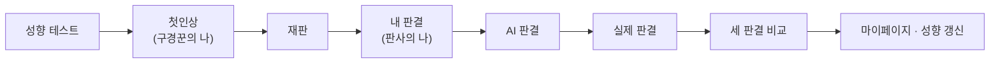

<p align="center">
  <picture>
    <source media="(prefers-color-scheme: dark)" srcset="./docs/assets/wordmark-dark.webp" />
    
  </picture>
</p>

<p align="center">
  다 알고 나서도, 같은 판단일까?<br />
  사건을 단계별로 읽고 직접 판결을 내린 뒤, AI · 실제 판결과 같은 기준으로 비교하는 판결 체험 서비스
</p>

<p align="center"><a href="https://naelawnambul.today">naelawnambul.today</a></p>

<div align="center">

|                                     백승호                                     |                                   정민석                                   |                                   김현중                                   |                                  김해송                                   |
|:---------------------------------------------------------------------------:|:-----------------------------------------------------------------------:|:-----------------------------------------------------------------------:|:----------------------------------------------------------------------:|
|  |  |  |  |
|              [@pooreunblue](https://github.com/pooreunblue)               |                [@jms0326](https://github.com/jms0326)                 |                [@YOLO-NIM](https://github.com/YOLO-NIM)                 |                 [@peanutboi710](https://github.com/peanutboi710)                 |
| AI 판결 · 비교 · 모니터링 · JWT | 인프라 · 배포 · 운영 · 카카오 로그인 | 성향 백엔드 · 보안 기반 · 판례 저장소 | 화면 · 캐릭터 · 성향 콘텐츠 · 관리자 검수 |

</div>

## 핵심 포인트

- 실제 판결은 마지막 막까지 비공개, 제출한 판단은 **서버가 진행 상태 7단계로 잠금**
- 사용자 · AI · 재판부 판단을 `judgment` 한 테이블에, "1회 제출"은 **부분 유니크 인덱스로 보장**
- AI 판결은 **미리 생성 → 관리자 검수 후 공개** (비식별화 · RAG · 사전 학습 점검 파이프라인)
- 관리자(세션 · CSRF) · 카카오 로그인(OAuth) · 사용자(JWT) **보안 필터 체인 3분리**
- IAM 권한 없이 서버가 이미지를 당겨 오는 **자동 배포**, 실패하면 직전 버전으로 자동 되돌림
- Grafana Cloud · Slack 경보, Nginx 요청 제한, 작업마다 남긴 **의사결정 기록 240건 이상**

## 체험 흐름



## 주요 화면

| 메인 | 첫인상 |
| :---: | :---: |
|  |  |
| **재판** | **내 판결** |
|  |  |
| **AI 판결** | **세 판결 비교** |
|  |  |
| **성향 테스트** | **관리자 검수** |
|  |  |

## 아키텍처

<p align="center">
  
</p>

## 기술 스택

| 구분 | 내용 |
| --- | --- |
| Backend | Java 17, Spring Boot 4.1.1 (Web MVC · Data JPA · Validation), Gradle |
| DB | PostgreSQL 17 + pgvector(RAG 유사 판례 검색), Flyway(스키마 마이그레이션) |
| Cache · 토큰 | Redis 7.4 |
| Frontend | HTML + JavaScript, Vite |
| 인프라 | AWS EC2 · RDS · S3, Docker Compose, Nginx(HTTPS · 요청 제한), GHCR |
| CI · CD | GitHub Actions(테스트 · 이미지 빌드) · 서버 `cd-agent`(`main` 자동 배포) |
| 모니터링 | Grafana Cloud(Alloy 에이전트) · Slack 경보 |

자세한 구성과 선택 이유는 [기술 스택 정리](docs/tech-stack.md), 운영 구성 전체는 [인프라 아키텍처](docs/architecture.md)를 본다.

## 상세 문서

| 문서 | 링크 |
| --- | --- |
| 전체 문서 안내 | [docs/README.md](./docs/README.md) |
| 기술 스택 · 선택 이유 | [docs/tech-stack.md](./docs/tech-stack.md) |
| API 명세 | [docs/api-specification.md](./docs/api-specification.md) |
| ERD | [docs/erd.md](./docs/erd.md) |
| 유저 흐름도 | [docs/user-flow.md](./docs/user-flow.md) |
| 인프라 아키텍처 | [docs/architecture.md](./docs/architecture.md) |
| AI 판결 파이프라인 | [docs/ai-judgment-pipeline.md](./docs/ai-judgment-pipeline.md) |
| 의사결정 기록 | [docs/decisions](./docs/decisions) |
| 배포 · 운영 | [deploy/README.md](./deploy/README.md) |
| 모니터링 | [monitoring/README.md](./monitoring/README.md) |
| Git · 코드 컨벤션 | [GIT_CONVENTIONS.md](./docs/conventions/GIT_CONVENTIONS.md) · [CODE_CONVENTIONS.md](./docs/conventions/CODE_CONVENTIONS.md) |

## 실행

### Backend

```bash
cd backend
docker compose up -d      # 로컬 PostgreSQL · Redis
./gradlew bootRun         # http://localhost:8080 (시작할 때 Flyway가 스키마 · 개발용 가상 사건을 넣는다)
```

### Frontend

```bash
cd frontend
npm install
npm run dev               # http://localhost:5173 (/api는 8080으로 프록시)
```

<details>
<summary>로컬 실행 상세 (시드 · 실제 사건 서브모듈 · 환경변수 · 테스트)</summary>

`./gradlew bootRun`은 **시드 위치를 자동으로 정한다**(BE-28, `backend/build.gradle`). 환경변수를 따로 줄 필요가 없다.

- 기본 `bootRun` 설정에서는 개발용 가상 사건 시드(`db/seed`)를 함께 넣는다. `FLYWAY_LOCATIONS`를 직접 지정하면 지정한 위치만 사용하므로, 가상 사건 시드도 사용하려면 `classpath:db/seed`를 포함한다. ([시드 설명](backend/src/main/resources/db/seed/README.md))
- 실제 대표 사건은 **비공개 저장소 서브모듈(`backend/private-seed`)에 SQL이 있으면** 자동으로 넣는다(BE-17). 접근 권한이 없으면 빈 폴더로 남고, 가상 사건만으로 그대로 개발할 수 있다.
- 시작할 때 `[bootRun] Flyway 위치(...)` · `[bootRun] 실제 사건 시드: 포함 / 없음` 두 줄이 찍힌다. 실제 사건이 안 보이면 이 줄부터 확인한다. (`FLYWAY_LOCATIONS`를 직접 지정했으면 포함 여부를 판정하지 않고 지정한 위치를 그대로 쓴다고만 찍힌다.)
- 위치를 직접 정하고 싶으면 `FLYWAY_LOCATIONS`를 주면 그 값을 그대로 쓴다. (예: 스키마만 `FLYWAY_LOCATIONS=classpath:db/migration ./gradlew bootRun`)

```bash
# 실제 사건을 보려면 저장소 루트에서 처음 한 번 (권한 필요)
git submodule update --init backend/private-seed
```

⚠️ `git pull`은 서브모듈을 갱신하지 않는다. 공개 저장소가 서브모듈 커밋을 올렸다면(예: `R__20` 재판부 판결 · `R__30` AI 판결 추가) pull 뒤에 `git submodule update --init backend/private-seed`를 다시 실행해야 한다. 그렇지 않으면 예전 커밋의 시드만 들어가고, `bootRun`은 SQL이 하나라도 있으면 "포함"으로 찍어 오류 없이 뜬다. 이때 실제 사건에서 `GET /api/v1/cases/{id}/experience/judgments/ai` · `/judgments/court`가 500(`IllegalStateException`, 공개 사건인데 AI · 재판부 판결 row가 없음)을 낸다. 아래로 확인한다. (BE-29)

```bash
git submodule status backend/private-seed   # 맨 앞이 '-'(미초기화) 또는 '+'(커밋 불일치)이면 위 update 명령 실행
ls backend/private-seed/seed                # R__10 · R__20 · R__30 세 파일이 있어야 한다
```

서브모듈을 맞춘 뒤 `bootRun`을 다시 띄우면 Flyway가 새 시드를 반복 마이그레이션(`R__`)으로 적용한다. DB를 비울 필요는 없다.

이 자동 설정은 로컬 실행(`bootRun`)에만 적용된다. 운영(jar · Docker)은 `application.yml` 기본값(스키마만), 테스트는 별도 `test` 프로필(스키마 + 공개 가상 시드)을 쓴다(BE-87).

⚠️ IDE에서 실행할 때는 `BackendApplication`의 ▶ 버튼(main 클래스 실행) 대신 Gradle 창의 `Tasks > application > bootRun`을 쓴다. main 클래스로 실행하면 Gradle을 거치지 않아 자동 설정이 적용되지 않고 `application.yml` 기본값(스키마만)으로 떠서, 새 DB라면 사건이 하나도 없다. 꼭 main 클래스로 실행해야 하면 실행 구성의 환경변수에 `FLYWAY_LOCATIONS`를 직접 넣는다.
- 서브모듈 안의 파일을 공개 저장소의 다른 위치(`db/seed` 등)로 **복사하지 않는다.** 공개 저장소의 커밋 메시지 · PR · Jira 댓글에도 사건 내용(형량 · 판단 요소 · 사실관계)을 쓰지 않는다.
- 서브모듈은 `src/main/resources` 밖에 있어 jar에 들어가지 않고, `backend/.dockerignore`로 Docker 빌드에서도 뺀다.

로컬 DB를 비우고 처음부터 다시 만들려면 `docker compose down -v && docker compose up -d`를 실행한다. (볼륨이 삭제된다 — 로컬 Redis 데이터도 함께 지워진다)

테스트는 개발 DB와 분리된 **테스트 전용 PostgreSQL(55432) · Redis(56379)** 에 연결한다(BE-87).
컨테이너 준비·macOS/Linux 및 Windows 명령·IDE 설정·정리 절차는 [backend/TESTING.md](backend/TESTING.md)를 따른다.
개발용 컨테이너만 실행한 상태로는 통합 테스트를 실행할 수 없다.

다음 접속 환경변수는 **개발·운영 서버 실행용**이다. 값이 없으면 로컬 `docker-compose.yml` 기본값을 쓴다. (`backend/src/main/resources/application.yml`)
테스트는 아래 변수를 상속하지 않고 `TEST_*` 설정과 접속 검증을 사용한다([테스트 환경 안내](backend/TESTING.md)).

| 이름 | 기본값 | 설명 |
| --- | --- | --- |
| `DB_URL` | `jdbc:postgresql://localhost:5432/lawnambul` | DB 접속 주소 |
| `DB_USERNAME` | `lawnambul` | DB 계정 (로컬 전용 값) |
| `DB_PASSWORD` | `lawnambul` | DB 비밀번호 (로컬 전용 값) |
| `DDL_AUTO` | `validate` | Hibernate 스키마 처리 방식 (스키마는 Flyway로만 바꾼다) |
| `FLYWAY_LOCATIONS` | `classpath:db/migration` (`bootRun`은 자동: 가상 시드 + 실제 사건이 있으면 포함) | 마이그레이션 위치. 주면 `bootRun` 자동 설정보다 우선한다. 가상 시드는 `classpath:db/seed`, 실제 사건은 `filesystem:./private-seed/seed` |
| `SWAGGER_ENABLED` | `false` | Swagger UI · OpenAPI 문서 노출. 로컬 · 개발에서만 `true`로 켠다 (`/swagger-ui/index.html`, `/v3/api-docs`) |
| `ADMIN_BOOTSTRAP_EMAIL` · `ADMIN_BOOTSTRAP_PASSWORD` | 없음 | (확장, BE-39) 첫 관리자 계정. 둘 다 있고 그 이메일의 계정이 없을 때만 기동 시 한 번 만든다(비밀번호 12자 이상). 만든 뒤 환경변수를 지운다. `ADMIN_BOOTSTRAP_NAME`으로 표시 이름 지정(기본 `관리자`) |
| `SESSION_COOKIE_SECURE` | `true` | (확장) 관리자 세션 · CSRF 쿠키의 Secure 속성. localhost는 Secure 쿠키를 그대로 받으므로 보통 바꿀 필요 없다 |
| `ADMIN_SESSION_TIMEOUT` | `30m` | (확장) 관리자 세션 유지 시간 |
| `JWT_SECRET` | 없음(필수) | (확장, BE-94) 액세스 토큰 서명 키. Base64, 디코딩 32바이트 이상. 없으면 기동이 실패한다(공개 저장소에 기본값을 두지 않는다 — 있으면 누구나 토큰을 위조할 수 있다). 로컬은 `export JWT_SECRET=$(openssl rand -base64 32)`처럼 각자 만들어 쓴다 |
| `JWT_ACCESS_TOKEN_TTL` · `JWT_REFRESH_TOKEN_TTL` | `15m` · `14d` | (확장, BE-94) 액세스 · 리프레시 토큰 유효 기간 |
| `KAKAO_CLIENT_ID` · `KAKAO_CLIENT_SECRET` | 없음 | (확장, BE-62) 카카오 로그인 REST API 키 · Client Secret. 비어 있으면 카카오 로그인 경로만 꺼진다. ID를 넣으면 SECRET도 필수(없으면 기동 실패). 로컬은 카카오 콘솔 Redirect URI에 `http://localhost:<포트>/api/v1/auth/oauth2/callback/kakao`를 등록해 쓴다 |
| `KAKAO_LOGIN_SUCCESS_REDIRECT` · `KAKAO_LOGIN_FAILURE_REDIRECT` | `/auth/callback` · `/auth/callback?error=login_failed` | (확장, BE-62) 로그인 성공 · 실패 후 보낼 화면 경로. 우리 사이트 안의 경로(`/...`)만 허용 |

운영 DB 계정은 이 저장소에 적지 않고 실행할 때 환경변수로만 넘긴다. 시드는 운영에 넣지 않는다.


- 테스트는 테스트 전용 PostgreSQL(55432) · Redis(56379)를 쓴다 → [backend/TESTING.md](./backend/TESTING.md)
- API 없이 화면만 보려면 `http://localhost:5173/preview.html` → [frontend/README.md](./frontend/README.md)

</details>

---

<sub>이 서비스의 사건은 실제 판결을 바탕으로 비식별 처리한 내용이며, 내Law남불은 법률 자문이나 특정 사건에 대한 법적 판단을 제공하지 않습니다.</sub>
