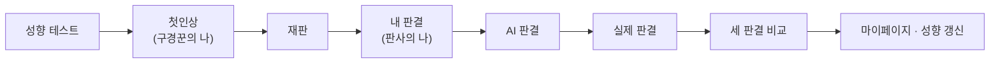
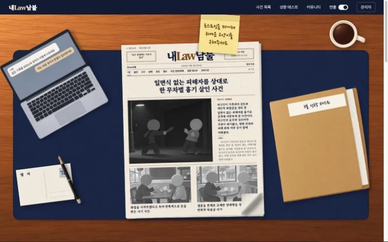
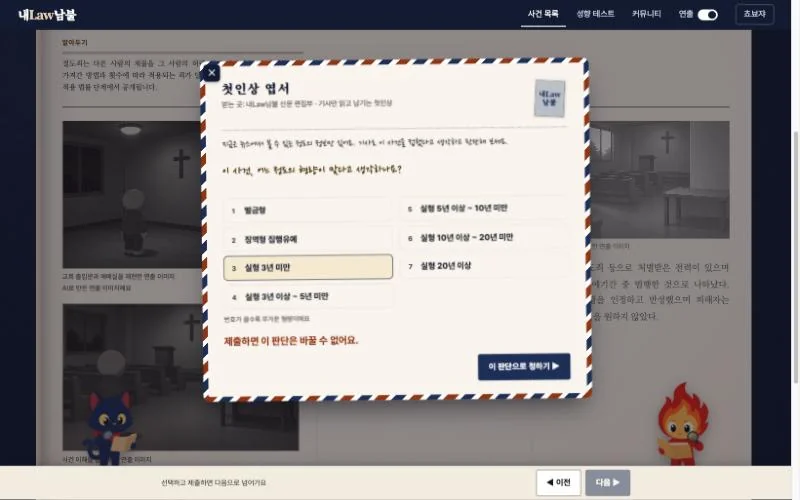
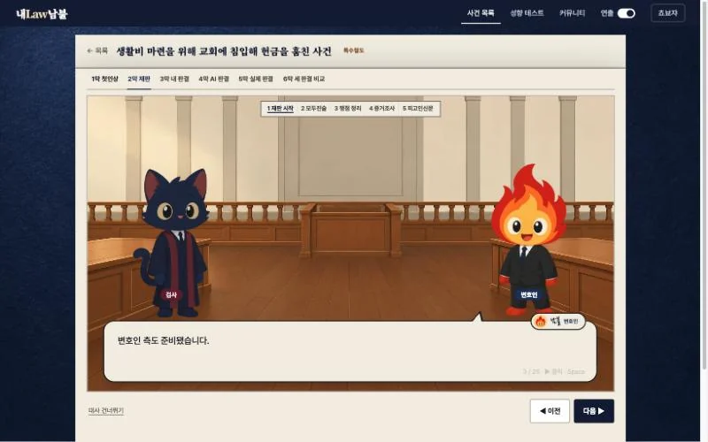
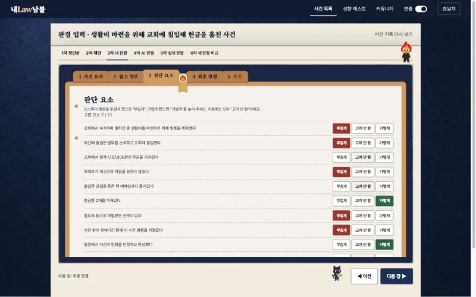
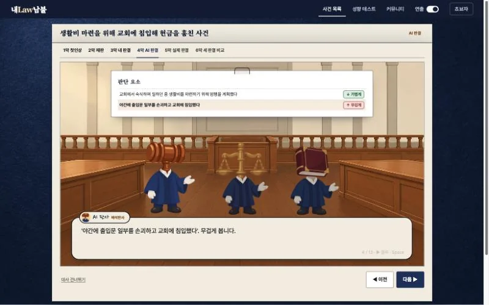
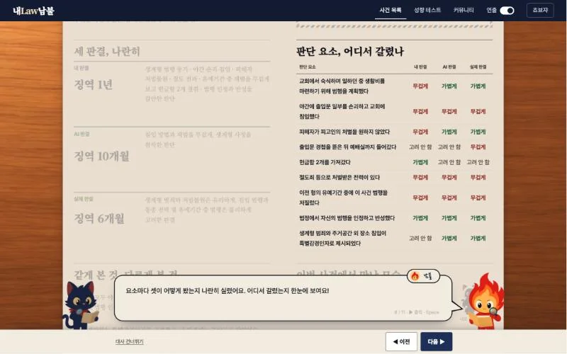
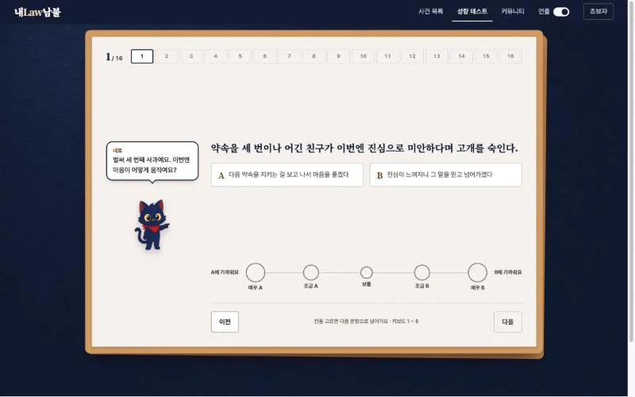
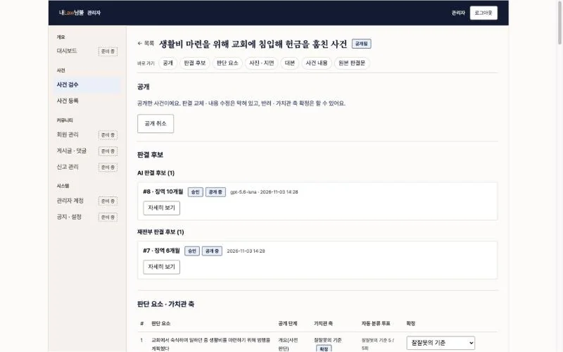
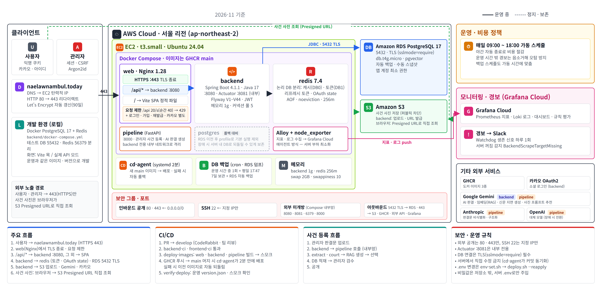

<p align="center">
  <picture>
    <source media="(prefers-color-scheme: dark)" srcset="./docs/assets/wordmark-dark.webp" />
    
  </picture>
</p>

<p align="center">
  다 알고 나서도, 같은 판단일까?<br />
  사건을 단계별로 읽고 직접 판결을 내린 뒤, AI · 실제 판결과 같은 기준으로 비교하는 판결 체험 서비스
</p>

<p align="center"><a href="https://naelawnambul.today">naelawnambul.today</a></p>

<div align="center">

|                                     백승호                                     |                                   정민석                                   |                                   김현중                                   |                                  김해송                                   |
|:---------------------------------------------------------------------------:|:-----------------------------------------------------------------------:|:-----------------------------------------------------------------------:|:----------------------------------------------------------------------:|
|  |  |  |  |
|              [@pooreunblue](https://github.com/pooreunblue)               |                [@jms0326](https://github.com/jms0326)                 |                [@YOLO-NIM](https://github.com/YOLO-NIM)                 |                 [@peanutboi710](https://github.com/peanutboi710)                 |
| <sub>AI 판결 · 비교<br/>JWT · 모니터링</sub> | <sub>공통 기반 · 에러<br/>카카오 OAuth<br/>Redis · RDS · 배포</sub> | <sub>성향 백엔드<br/>보안 · 관리자 API<br/>판례 저장소</sub> | <sub>화면 · 캐릭터<br/>성향 콘텐츠<br/>관리자 검수 화면</sub> |

</div>

## 핵심 포인트

- 실제 판결은 마지막 막까지 비공개, 제출한 판단은 **서버가 진행 상태 7단계로 잠금**
- 사용자 · AI · 재판부 판단을 `judgment` 한 테이블에, "1회 제출"은 **부분 유니크 인덱스로 보장**
- AI 판결은 **미리 생성 → 관리자 검수 후 공개** (비식별화 · RAG · 사전 학습 점검 파이프라인)
- 관리자(세션 · CSRF) · 카카오 로그인(OAuth) · 사용자(JWT) **보안 필터 체인 3분리**
- IAM 권한 없이 서버가 이미지를 당겨 오는 **자동 배포**, 실패하면 직전 버전으로 자동 되돌림
- Grafana Cloud · Slack 경보, Nginx 요청 제한, 작업마다 남긴 **의사결정 기록**

## 체험 흐름



## 주요 화면

| 메인 | 첫인상 |
| :---: | :---: |
|  |  |
| **재판** | **내 판결** |
|  |  |
| **AI 판결** | **세 판결 비교** |
|  |  |
| **성향 테스트** | **관리자 검수** |
|  |  |

## 아키텍처

<p align="center">
  
</p>

## 기술 스택

| 구분 | 내용 |
| --- | --- |
| Backend | Java 17, Spring Boot 4.1.1 (Web MVC · Data JPA · Validation), Gradle |
| DB | PostgreSQL 17 + pgvector(RAG 유사 판례 검색), Flyway(스키마 마이그레이션) |
| Cache · 토큰 | Redis 7.4 |
| Frontend | HTML + JavaScript, Vite |
| 인프라 | AWS EC2 · RDS · S3, Docker Compose, Nginx(HTTPS · 요청 제한), GHCR |
| CI · CD | GitHub Actions(테스트 · 이미지 빌드) · 서버 `cd-agent`(`main` 자동 배포) |
| 모니터링 | Grafana Cloud(Alloy 에이전트) · Slack 경보 |

자세한 구성과 선택 이유는 [기술 스택 정리](docs/tech-stack.md), 운영 구성 전체는 [인프라 아키텍처](docs/architecture.md)를 본다.

## 상세 문서

| 문서 | 링크 |
| --- | --- |
| 전체 문서 안내 | [docs/README.md](./docs/README.md) |
| 기술 스택 · 선택 이유 | [docs/tech-stack.md](./docs/tech-stack.md) |
| API 명세 | [docs/api-specification.md](./docs/api-specification.md) |
| ERD | [docs/erd.md](./docs/erd.md) |
| 유저 흐름도 | [docs/user-flow.md](./docs/user-flow.md) |
| 인프라 아키텍처 | [docs/architecture.md](./docs/architecture.md) |
| AI 판결 파이프라인 | [docs/ai-judgment-pipeline.md](./docs/ai-judgment-pipeline.md) |
| 의사결정 기록 | [docs/decisions](./docs/decisions) |
| 배포 · 운영 | [deploy/README.md](./deploy/README.md) |
| 모니터링 | [monitoring/README.md](./monitoring/README.md) |
| Git · 코드 컨벤션 | [GIT_CONVENTIONS.md](./docs/conventions/GIT_CONVENTIONS.md) · [CODE_CONVENTIONS.md](./docs/conventions/CODE_CONVENTIONS.md) |

## 실행

### Backend

```bash
cd backend
docker compose up -d                         # PostgreSQL · Redis
export JWT_SECRET=$(openssl rand -base64 32)  # 필수, 기본값 없음 (BE-94)
./gradlew bootRun                            # http://localhost:8080
```

### Frontend

```bash
cd frontend
npm install
npm run dev                     # 목 데이터로 실행 (백엔드 없이)
VITE_API_MODE=real npm run dev  # 실제 백엔드(8080) 연동
```

<details>
<summary>로컬 실행 상세 (시드 · 실제 사건 서브모듈 · 환경변수 · 테스트)</summary>

**시드**

- `bootRun`은 스키마와 개발용 가상 사건을 자동으로 넣는다(BE-28). 실제 사건은 비공개 서브모듈에 SQL이 있을 때만 들어간다(BE-17).
- IDE에서는 `BackendApplication` ▶ 대신 Gradle `bootRun`으로 실행한다. main 클래스로 띄우면 시드 자동 설정이 빠진다.
- 로컬 DB 초기화: `docker compose down -v && docker compose up -d`

**실제 사건 서브모듈** (권한 필요)

```bash
git submodule update --init backend/private-seed   # 처음 한 번, 그리고 pull 뒤에도 다시 실행 (BE-29)
```

- 서브모듈 파일을 공개 저장소의 다른 위치로 복사하지 않고, 커밋 · PR · Jira에 사건 내용을 쓰지 않는다.

**환경변수** (`DB_*` · `REDIS_*`만 값이 없으면 로컬 `docker-compose.yml` 기본값을 쓴다. 전체 목록은 `application.yml`)

| 이름 | 설명 |
| --- | --- |
| `JWT_SECRET` | 필수. `export JWT_SECRET=$(openssl rand -base64 32)` |
| `DB_URL` · `DB_USERNAME` · `DB_PASSWORD` | 운영 · 개발 서버 접속 값 |
| `FLYWAY_LOCATIONS` | 주면 `bootRun` 자동 시드 설정보다 우선 |
| `SWAGGER_ENABLED` | 로컬에서만 `true` (`/swagger-ui/index.html`) |
| `ADMIN_BOOTSTRAP_EMAIL` · `ADMIN_BOOTSTRAP_PASSWORD` | 첫 관리자 계정. 만든 뒤 지운다 |
| `KAKAO_CLIENT_ID` · `KAKAO_CLIENT_SECRET` | 비우면 카카오 로그인만 꺼진다 |

**테스트 · 화면만 보기**

- 테스트는 테스트 전용 PostgreSQL(55432) · Redis(56379)를 쓴다 → [backend/TESTING.md](./backend/TESTING.md)
- API 없이 화면만 보려면 `http://localhost:5173/preview.html` → [frontend/README.md](./frontend/README.md)

</details>

---

<sub>이 서비스의 사건은 실제 판결을 바탕으로 비식별 처리한 내용이며, 내Law남불은 법률 자문이나 특정 사건에 대한 법적 판단을 제공하지 않습니다.</sub>
