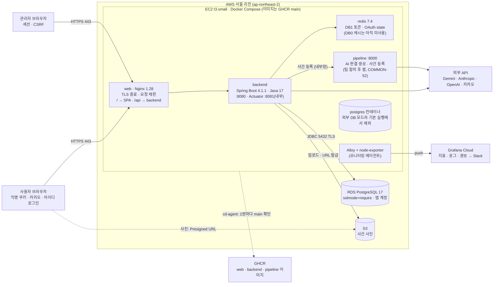

# 인프라 아키텍처 (운영 · 배포 · 모니터링 한눈에 보기)

운영 서비스(https://naelawnambul.today)가 어떤 구성으로 돌고, 코드가 어떻게 운영까지 가는지 한 문서로 정리한다.
**세부 절차 · 명령은 각 상세 문서에 있다** — 이 문서는 지도이고, 바꿀 때는 상세 문서와 설정 파일을 먼저 고친다.

| 버전 | 날짜 | 내용 |
| --- | --- | --- |
| v1 | 2026-11-02 | 신설 (COMMON-71). 11/01 기준 아키텍처 그림을 저장소 설정(compose · nginx · workflows · `.env.example`)과 대조해 정리. Supabase 공용 DB 종료(COMMON-59) 반영. 서버 가동은 매일 09:00 ~ 18:00(주말 포함). 공유용 그림 `docs/assets/architecture.png` 추가 |

## 상세 문서

| 알고 싶은 것 | 문서 |
| --- | --- |
| 서버 실행 · 배포 · HTTPS · 요청 제한 · Redis · 백업 · RDS · S3 · Swap · 파이프라인 · 모니터링 에이전트 | [`deploy/README.md`](../deploy/README.md) |
| 기술 선택 이유 · DB 운영 단계 · Redis 정책 · 보안 체인 | [`docs/tech-stack.md`](tech-stack.md) 2 · 3 · 8장 |
| CI · 이미지 빌드 · 운영 배포 확인 | [`.github/workflows/README.md`](../.github/workflows/README.md) |
| 지표 · 로그 · 대시보드 · 경보 · Slack | [`monitoring/README.md`](../monitoring/README.md) |
| AI 판결 파이프라인 서비스 | [`tools/ai-judgment/service/README.md`](../tools/ai-judgment/service/README.md) · [`docs/ai-judgment-pipeline.md`](ai-judgment-pipeline.md) |
| 로컬 테스트 DB | [`backend/TESTING.md`](../backend/TESTING.md) |
| 왜 그렇게 정했는지 | `docs/decisions/` — BE-58(이미지) · BE-59(외부 DB · RDS) · BE-60(CD) · BE-61(Redis) · BE-63(요청 제한) · BE-75(HTTPS) · COMMON-43 · 61 ~ 64(모니터링) · COMMON-47(S3) · COMMON-50(파이프라인) · COMMON-54(Swap) · COMMON-67 · 70(보안 헤더 · CSP) |

## 전체 구성

발표 · 포트폴리오용 상세 그림은 [`docs/assets/architecture.png`](assets/architecture.png)에 있다(2026-11 기준). 아래 Mermaid는 저장소에서 바로 고치는 간단한 구성도다. **구성이 바뀌면 두 그림을 함께 고친다.**



> 점선 박스(`postgres`)는 정의 · 볼륨만 남긴 되돌리기용이다. `pipeline`은 오버레이(`PIPELINE_SERVICE=1`)를 켠 서버에서만 뜬다.

## 운영 서버

| 항목 | 내용 | 상세 |
| --- | --- | --- |
| 서버 | EC2 t3.small(2GB) 한 대, 탄력적 IP. **스테이징 없음** — `main`이 곧 운영 | `deploy/README.md` |
| **운영 시간** | **매일 09:00 ~ 18:00에만 켜져 있다**(처음엔 평일만이었고, 주말 가동으로 바뀌었다). 그 밖 시간에는 서비스 · 백업이 멈추고, 경보는 음소거 `운영시간외`로 울리지 않는다. 저녁에 서버를 켜고 작업하면 장애 알림도 오지 않는다. | `deploy/README.md` "운영 DB 백업" · `monitoring/README.md` "알림 경로 · 음소거" |
| 도메인 · 인증서 | `naelawnambul.today` → 탄력적 IP. HTTP 80은 443으로 이동. Let's Encrypt(certbot) 90일 인증서, 자동 갱신 | BE-75 |
| 메모리 배분 | backend 1g · redis 256m (+ 모니터링 에이전트). RDS 전환으로 postgres 512m이 빠졌다. swap 2GB · `swappiness 10`은 순간 급증용 안전망 | COMMON-54 |
| DB | RDS PostgreSQL 17(`db.t4g.micro`, 단일 AZ), `vector` 확장, 앱 계정 `lawnambul_app`(마스터 아님). 연결 풀 5 | `deploy/README.md` "RDS 전환" |
| 파일 | S3 버킷 하나(퍼블릭 차단, SSE-S3). EC2 IAM 역할로 접근하고, 브라우저에는 Presigned URL로만 준다 | COMMON-47 |
| Redis | DB 0 캐시(지금 쓰는 코드 없음) · DB 1 토큰 저장소(리프레시 토큰 · OAuth state). AOF `everysec` · `noeviction` · 모든 키 TTL | `tech-stack.md` 2장 |

## 요청 흐름

1. 브라우저 → `https://naelawnambul.today` (443). Nginx가 TLS를 끝내고 보안 헤더 · HSTS(1일)를 붙인다.
2. Nginx 요청 제한: `/api` 전체 IP별 초당 20번(순간 40), 넘으면 JSON 429. 경로별로 더 좁게 — 카카오 로그인 분당 30, 토큰 재발급 · 로그아웃 분당 30, 관리자 로그인 분당 5, 회원 로그인 분당 20 · 가입 분당 10.
3. `/api/*` → backend `:8080`, 그 밖 → SPA 정적 파일(없는 경로는 `index.html`).
4. backend → Redis(토큰) · RDS(5432 TLS) · S3(사진 업로드 · Presigned URL 발급).
5. 사건 사진은 브라우저가 S3에서 직접 받는다(CSP `img-src`에 S3 주소 허용).

## 외부 서비스

| 서비스 | 누가 | 용도 |
| --- | --- | --- |
| 카카오 OAuth2 | backend | 소셜 로그인(BE-62). `KAKAO_CLIENT_ID`가 없으면 경로가 꺼진다 |
| Google Gemini | backend | RAG 유사 판례 검색 임베딩 · 신문 지면 생성(BE-92) · 사진 프롬프트 추천(BE-89). 키가 없으면 그 기능만 꺼진다 |
| Google Gemini | pipeline | AI 판결 생성(기본 `PIPELINE_MODELS`) · 임베딩 |
| Anthropic · OpenAI (· Groq · NVIDIA) | pipeline | 비식별화 · 구조화(추출) 모델과 대체 모델. 추출 기본값은 Anthropic(`PIPELINE_EXTRACT_MODEL`을 비웠을 때) |
| GHCR | Actions · 서버 | 운영 이미지 저장소 |
| Grafana Cloud · Slack | 모니터링 에이전트 | 지표 · 로그 저장, 경보 평가, Slack 알림 |

> **운영 확인 필요**: 운영 `.env`의 `PIPELINE_MODELS` · `PIPELINE_EXTRACT_MODEL` 실제 값, 그리고 `pipeline` · `postgres` 컨테이너가 지금 떠 있는지(위 그림은 저장소 설정 기준이다).

## 배포 흐름 (CI/CD)

```text
PR → develop      backend CI · frontend CI · deploy images(build: 이미지 3개 빌드 → 운영 구성으로 스모크 테스트) · CodeRabbit · 팀 리뷰
develop 머지      deploy images publish → GHCR develop 태그 (운영 배포 없음)
develop → main    deploy images publish → GHCR main 태그
                  → 서버 cd-agent(2분마다)가 새 main 이미지를 보고 저장소 사본을 그 커밋으로 맞춘 뒤 deploy.sh
                  → backend 교체 → healthy 확인 → web 교체 → smoke-test.sh → 실패하면 직전 이미지로 되돌림
                  → Actions verify-deploy가 운영 /version.json = 이 커밋인지 확인 → 운영 주소로 스모크 테스트
```

- Actions는 서버에 들어가지 않는다(SSH · AWS 권한 없음). 서버가 밖으로 나가 GHCR을 확인한다(BE-60).
- 마이그레이션은 backend가 뜰 때 Flyway가 적용한다. 되돌림은 이미지만 되돌리고 스키마는 되돌리지 않으므로, 마이그레이션은 이전 앱과 호환되게(추가만) 쓴다(BE-60).
- 큰 배포 전에는 RDS 수동 스냅샷을 찍는다.

## 보안 그룹 · 포트

| 방향 | 포트 | 상대 |
| --- | --- | --- |
| 인바운드 | 80 · 443 | 전체(0.0.0.0/0) |
| 인바운드 | 22 | 배포 담당 IP만 |
| 열지 않음 | 8080(backend) · 8081(Actuator) · 6379(Redis) · 8000(pipeline) | Compose 내부망에서만. 파이프라인은 backend만 있는 별도 네트워크 |
| 아웃바운드 | 5432 TLS → RDS, 443 → S3 · GHCR · 외부 API · Grafana Cloud | |

## 백업 · 복구

| 무엇 | 언제 | 보관 |
| --- | --- | --- |
| `backup-db.sh` 덤프(RDS `public` 스키마) | 매일 운영 시간 중 1번 + 평일 17:47 | 7일 |
| RDS 자동 백업 | 매일 | 콘솔 설정 |
| RDS 수동 스냅샷 | `loads/` 실행 · 큰 데이터 변경 · 큰 `main` 머지 직전 | 직접 지울 때까지(안 쓰면 지운다 — 저장 용량 요금) |

## 운영 규칙

- 서버의 저장소 사본 · 설정 파일을 직접 고치지 않는다. `cd-agent`가 배포 때 커밋으로 맞춘다.
- `.env`는 `./env-set.sh`로 바꾸고 `./deploy.sh --reapply`로 적용한다(이미지가 같아 자동 배포가 하지 않는다).
- DB 연결은 TLS(`sslmode=require`) 필수. 실제 사건 시드는 팀 합의 표시(`EXTERNAL_DB_ALLOWS_REAL_SEED=1`)가 있어야 올라간다.
- Actuator(8081)는 밖으로 열지 않는다. 운영 서버에는 Prometheus를 두지 않고 Grafana Cloud에서 평가한다.

## 로컬 개발

| 무엇 | 구성 |
| --- | --- |
| 개발 DB · Redis | `backend/docker-compose.yml` — PostgreSQL 17(pgvector) · Redis. 팀 공용 DB는 없다(RDS 전환 전에 쓰던 Supabase 공용 DB는 종료, COMMON-59) |
| 테스트 | 별도 PostgreSQL(55432) · Redis(56379), `backend/docker-compose.test.yml` — [`backend/TESTING.md`](../backend/TESTING.md) |
| 화면 | `frontend`에서 `npm run dev`(Vite). 목 모드 · 실제 API 모드 — [`frontend/README.md`](../frontend/README.md) |
| 운영 구성 확인 | `deploy/docker-compose.prod.yml`로 로컬에서 띄우기 — `deploy/README.md` "로컬에서 운영 구성 확인" |
