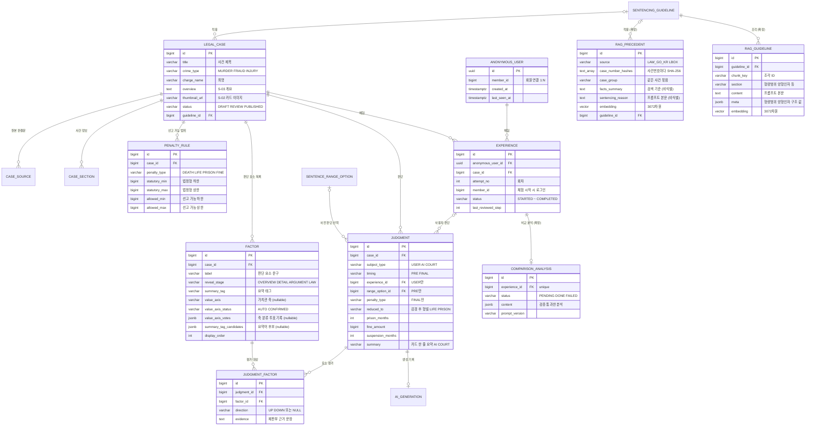
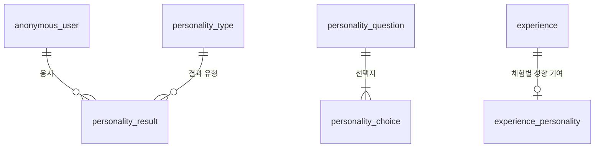
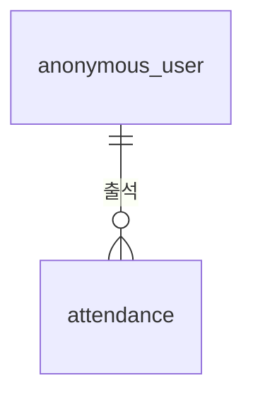
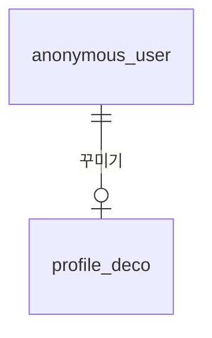
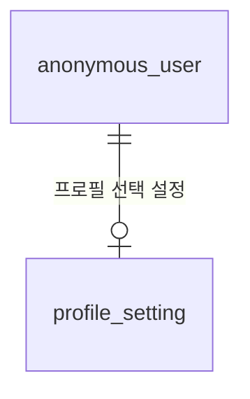

**작성 이력**

| 버전 | 날짜 | 내용 |
| --- | --- | --- |
| **v0.1** | **2026-09-28** | **초안** • 테이블 11개 •  관계도 •  컬럼 정의 •  상태 전이 규칙 •  결정 필요 사항 |
| v1.0 | 2026-09-28 | 결정 사항 확정 • 결정 #1~#6 확정(4장) • judgment 구현 규칙 추가(7장) • experience에 attempt_no · member_id 추가 및 유니크 제약 변경(재체험·회원 연결 대비) • penalty_rule을 법정형 / 선고 가능 범위로 분리 |
| v1.1 | 2026-09-28 | 비교 분석 실시간 생성(시퀀스 v0.2 안 B) 반영 • comparison_analysis 테이블 추가(확장 단계, 체험당 1개) • 관계도 · 서버 규칙 갱신 |
| **v1.3** | **2026-09-29** | **문서 정합성 점검 결정 반영 (COMMON-4)** • DB를 PostgreSQL로 확정(기술 스택 2장): 타입을 `jsonb` · `timestamptz`로, MySQL 관련 문구 삭제 • `judgment.references` → `reference_tags` (SQL 예약어 회피) • 무죄(`NOT_GUILTY`) MVP 제외 • 경합범 서비스 제외에 따라 예시 데이터(6장)를 단일 범행 사건으로 교체 • `legal_case.thumbnail_url` · `deidentified_items`(확장), `factor.summary_tag`, `judgment.summary` 추가, 범죄 분류명은 코드 상수 |
| **v1.4** | **2026-09-30** | **대표 사건(살인) 가공 결정 반영 (BE-13)** • `penalty_type`에 사형(`DEATH`) · 무기징역(`LIFE`) 추가. `LIFE` · `DEATH` 행의 `allowed_min` ~ `allowed_max`는 작량감경해 징역으로 선고할 때의 범위(무기 → 10 ~ 50년, 사형 → 20 ~ 50년) • `judgment.reduced_to`(감경 후 형벌) 추가, 형벌 종류별 CHECK · 선고 가능 범위 검증 규칙 갱신 • `sentence_range_option.kind`에 `LIFE` · `DEATH` 추가 • `extra_dispositions.type` 값 목록 명시, 몰수(`CONFISCATION`) 추가 • `penalty_rule` 예 3(살인) 추가 • `reduced_to`는 형벌 종류가 바뀌는 감경만 기록한다고 명시, 살인은 `sentence_range_option`에 `FINE` 구간을 두지 않음 |
| v1.5 | 2026-09-30 | 예시 사건을 가상 살인 사건으로 교체 (COMMON-11) • 6장 예시 데이터를 "빌린 돈 문제로 찾아온 지인을 살해한 사건"(가상)으로 전면 교체: `penalty_rule` 3행(사형 · 무기 · 징역), 살인용 `sentence_range_option` 8개, 판단 요소 11개, 세 판결 · 매트릭스 · 변화 유형 • `case_section` · `factor` 설명의 사기 예시 문구 교체 |
| v1.2 | 2026-09-28 | 전체 문서 교차 검토 반영 • case_section.stage에 SUMMARY 추가 · 섹션 •  출처 명시, 공개 판단 유일 조건을 (case_id, subject_type)별로 정정 • 형벌 종류별 CHECK 제약 추가 • judgment.references 추가 (v1.3에서 `reference_tags`로 변경) • 선고 가능 하한 정의 명확화(법률상 감경 + 작량감경) · 벌금 예시 하한 25,000원 • last_reviewed_step 규칙 • 선택 FK 관계선 표기 • 서버 규칙 표 보완 |
| v1.6 | 2026-09-30 | BE-16 시드 반영 • 6장 `sentence_range_option` 예시를 V1이 넣은 실제 `id`(8 ~ 15) · `display_order`(2 ~ 9)로 정정, 사용자 사전 판단 예시 구간을 11로 정정 |
| v1.5 | 2026-09-30 | BE-2 마이그레이션 반영 • `penalty_rule` 유니크 (`case_id`, `penalty_type`), `DEATH` · `LIFE` 행 CHECK(법정형 NULL, 집행유예 불가) • `experience` CHECK(`last_reviewed_step` 0 ~ 4, `attempt_no` 1 이상), `comparison_analysis.fail_reason` CHECK 명시 • `judgment` CHECK: 형량 값 양수(`prison_months` · `fine_amount` · `suspension_months` > 0), 사용자 판단은 항상 공개(PR #26 리뷰 반영) • 7장에 마이그레이션 공통 규칙 추가 • `penalty_rule` 컬럼 표 중간의 `DEATH` · `LIFE` 설명을 표 아래로 옮김(표가 끊겨 마지막 3개 컬럼이 표로 보이지 않던 문제) |
| v1.7 | 2026-10-01 | BE-3 엔티티 반영 — 7장 마이그레이션 공통 규칙에 jsonb 형식(배열 컬럼, `case_section.data` 원소 형식, 부가 처분 `type` 값) 추가 |
| v1.8 | 2026-10-01 | BE-3 리뷰 반영 — `case_source` 최종 확정 판결 부분 유니크(V6 마이그레이션) 추가, `comparison_analysis`는 `PENDING`일 때만 `DONE` · `FAILED`로 바뀜(엔티티 규칙) |
| v1.9 | 2026-10-02 | 사건 정보 섹션 표시 방식 팀 결정 반영 (BE-17) • `case_section.content`는 항목 하나를 한 줄로 쓰고 줄바꿈(`\n`)으로 나눈다. 화면은 줄바꿈을 그대로 보여 준다(7장 규칙 추가) • 양측 주장(`PROSECUTOR` · `DEFENSE`) 섹션 위 안내 문구는 DB에 두지 않고 화면 고정 문구로 둔다. 컬럼을 추가하지 않는다 • `penalty_rule.display_order` 규칙 추가: 법조문 표기 순서대로 무거운 형벌부터(사형 → 무기 → 징역 → 벌금). 예시 · 가상 시드는 이미 이 순서이고 실제 사건 시드(비공개)를 맞춤 |
| v1.10 | 2026-10-06 | 판단 요소별 요약어 기준 확정 반영 (BE-26) • `factor.summary_tag` 설명을 "요소를 묶는 분류명"에서 "요소마다 붙이는 요약어"로 정정 • 6장 `factor` 예시의 `summary_tag` 11개 값을 요소별 요약어로 교체(가상 시드 · 프론트 목과 같은 값) |
| v1.11 | 2026-10-07 | AI 판결 자동 파이프라인 · 후검수 반영 (BE-31) • `ai_generation.generation_report`(jsonb) 추가(V8 마이그레이션): 자동 생성 정보(검증 경고 · 사전 학습 점검 판정 · 회차 선택 · 실행 식별자 `runKey`) • 자동 적재는 AI 판결을 비공개(`is_published=false`) · `PENDING`으로, 사건을 `DRAFT`로 넣고 관리자가 검수 후 공개한다 |
| v1.12 | 2026-10-08 | COMMON-19 반영 (AI 판결 파이프라인 BE-31 ~ BE-45) • `legal_case.title` · `factor(case_id, display_order)` 유일 제약 설명 추가(V7, 적재 SQL의 조회 키) • `legal_case.incident_date`: 자동 파이프라인이 원문 · 선고일과 대조해 확인한 값을 넣는다(BE-38) • 자동 적재는 재판부 판결(COURT)도 비공개(`is_published=false`)로 넣고, 다시 돌리면 비공개 후보가 쌓일 수 있음을 명시(BE-38) • `generation_report` 내용 구체화: 점검 판정 · 분류별 개수 · 기준(`criteria`) 등. 코드 변경 없음, 설명만 정정 |
| v1.13 | 2026-10-08 | 판단 요소 가치관 축 추가 (BE-47) • `factor.value_axis` 추가(V9 마이그레이션, nullable): 판결 체험에서 고르는 판단 요소를 사용자 성향과 매칭하는 가치관 축 4개(`APOLOGY_SINCERITY` · `FAULT_STANDARD` · `PRINCIPLE_RELATION` · `ORDER_OPPORTUNITY`) 또는 NULL • 사전 판단(`OVERVIEW`)과 형량 선택은 성향 계산에 쓰지 않는다(계산하는 쪽에서 제외) |
| v1.14 | 2026-10-08 | 11 · 12차 회의 반영 (COMMON-20) • `comparison_analysis`: AI 비교 분석(REQ-063) 제외로 보류. V5 마이그레이션의 테이블은 그대로 두고 쓰지 않는다(삭제 여부 미정) • 8장 신설: 판결 성향 테스트 테이블 제안(미확정) — 문항 · 선택지 · 유형 · 결과 · 체험별 성향 기여. 판단 요소별 가치관 축은 새로 만들지 않고 `factor.value_axis`(v1.13, BE-47)를 쓴다 |
| v1.15 | 2026-10-08 | 판단 요소 가치관 축 후검수 반영 (BE-48) • `factor.value_axis_status` 추가(V10 마이그레이션, 기본 `AUTO`): `AUTO`(AI 투표 · 사람 초안 기본값) / `CONFIRMED`(관리자 확정, NULL 확정 포함). 시드 · 적재 SQL은 `CONFIRMED` 행을 덮어쓰지 않는다 • `factor.value_axis_votes`(jsonb) 추가: 축 분류 투표 기록(BE-49). 최다표가 요청 횟수의 과반이 아니면(동률 · 유효 응답 부족 포함) `needsReview` |
| v1.16 | 2026-10-10 | AI 판결 RAG 판례 저장소 추가 (BE-51) • `rag_precedent` 추가(V11 마이그레이션, pgvector `vector(3072)`): 비식별화한 사실관계 요약(검색 기준 · 임베딩 입력) · 양형 이유 · 법조문 · 주문 형량 · 양형인자 · 사건 그룹 · 사건번호 해시(병합 사건은 번호마다). 판결문 원문 · 사건번호 · 법원명은 넣지 않는다 • 검색 함수 `rag_precedent_search`: 자기 사건(사건번호 해시가 있는 사건 그룹 전체) 제외, 사건 그룹당 1건, 점수 하한 · 개수 제한 • 검색어 임베딩 · 검색은 백엔드 `RagSearchService`(Java), 판례 적재는 오프라인 `rag_store.py`(Python) • 사용 보류 `on_hold` · `hold_reason`: LBox 판례는 라이선스 확인 전까지 보류(검색 제외) • 사용자 API에서 조회하지 않는 오프라인 파이프라인 전용 테이블. 행은 비공개 시드 `R__40`이 넣는다 |
| v1.17 | 2026-10-13 | 관리자 계정 추가 (**확장 단계**, BE-39 — 닫힌 #79를 최신 develop에 다시 적용) • `admin_account`(V12 마이그레이션): 관리자 후검수 API 로그인 계정. 사용자(익명 ID)와 관계없음 |
| v1.18 | 2026-10-12 | AI 판결 RAG 양형기준 저장소 추가 (BE-52) • `rag_guideline` 추가(V13 마이그레이션, pgvector `vector(3072)`): 양형기준 한 버전 × 한 섹션 × 한 대상 조각 · 임베딩 입력(머리말 + 본문) · 구조 값 `meta`(형량범위 · 양형인자) • `sentencing_guideline` (`crime_category`, `version_name`) 유니크. 살인범죄 6개 버전(2009 최초 ~ 2026 수정)을 비공개 시드 `R__41`이 넣는다 • 함수 `sentencing_guideline_at`(기준일 → 시행 중 버전) · `rag_guideline_search`(버전 안 검색) • 버전 기준일은 공소제기일 → 없으면 발생일(결정은 [양형기준 저장소](sentencing-guideline-rag.md) 6장) |
| v1.19 | 2026-10-13 | 관리자 감사 로그 추가 (**확장 단계**, BE-68 · WBS 7.4.5) — `admin_audit_log`(V14): 누가(`admin_id` · `actor_email`) · 무엇을(`action` 9종) · 어디에(`target_type` · `target_id`) · 상세(`detail` jsonb, 비밀번호 · 원문 제외) · IP · 시각. 계정이 지워져도 기록은 남는다(`ON DELETE SET NULL`). 성향 DB는 다음 번호(V15)를 쓴다 |
| v1.20 | 2026-10-14 | 판결 성향 테스트 테이블 확정 (**확장 단계**, BE-69 · WBS 7.6.3) — 8장 제안을 V15 마이그레이션으로 확정 • `personality_question`에 두 행동 문장 `option_a` · `option_b` 추가. 선택지는 5칸 고정이고 "매우 · 조금 · 보통"은 화면이 붙이므로 `personality_choice.content` 삭제(글자 · 점수 · 순서만) • 선택지 축은 복합 FK(`question_id`, `axis`)로 문항 축과 같게 묶고, 글자는 그 축의 두 글자만 · 보통은 글자 없음 0점(CHECK) • `personality_type`: 공유 주소 `share_id` 추가(#119, 코드는 화면 · 주소에 안 씀), `animal` → `character_code`(NAERO · NAMBUL), `description` → `meme` · `daily_description` · `verdict_description`, `tolerance`는 코드의 I · N · F · P 개수(CHECK) • `personality_result`: 현재 결과는 사용자당 1건(부분 유니크 인덱스) • `experience_personality`: `axis_scores` · `type_code` → 축별 고른 개수 `axis_counts`(`{down, up}`, 산식 문서 v0.4) |
| v1.21 | 2026-10-14 | 성향 콘텐츠 시드 추가 (**확장 단계**, BE-72 · WBS 7.6.4) — `db/migration/R__personality_content.sql`(반복 마이그레이션, **운영에도 적용**): 유형 16 · 문항 16 · 선택지 80. upsert라 다시 실행해도 선택지 id · `share_id`는 바뀌지 않는다(응답 기록 · 공유 링크 보존). `image_url`은 이미지가 들어오기 전까지 NULL. 스키마 변경 없음 |
| v1.23 | 2026-10-15 | RAG 판례 · 양형기준 설명 갱신 (BE-54, **스키마 변경 없음**) — `rag_precedent`: LBox 행 삭제(사용 불가) · `guideline_id`는 NULL로 두고 검색 때 발생일로 버전을 고름 · `flags.guidelineBasis` · 오프라인 생성 검색은 Python(`rag_context.py`) · 점수 기준(하한 0.70 · 상한 0.88). `legal_case.guideline_id`는 적재 때 기준일(공소제기일 → 발생일)로 채움 |
| v1.22 | 2026-10-14 | 판결 후보 검수 기록 (**확장 단계**, BE-41 · WBS 7.4.7, V16) — `judgment`에 `review_status`(APPROVED · REJECTED, NULL = 기록 없음) · `reviewed_by_admin_id` · `reviewed_at` · `review_note` 추가. AI · 재판부 후보를 같은 방식으로 검수한다(재판부는 지금까지 반려를 둘 곳이 없었다, API 명세 8-3 #4). 제약: 사용자 판단은 검수 값 없음, 반려 후보는 공개 불가, 사유는 반려에만. 기존 데이터는 `ai_generation`의 검수 결과와 공개 중 판결(승인)을 옮겼다. `ai_generation.review_status` · `reviewed_by`는 기존 도구용으로 남긴다(승인 · 반려 때 함께 맞춤, BE-42) |
| v1.24 | 2026-10-16 | 판단 요소 요약어 후보 추가 (**확장 단계**, BE-80 · V17) — `factor.summary_tag_candidates`(jsonb, nullable). 적재 SQL(`case_seed_sql.py`)이 새 사건을 넣을 때 보고서 후보를 넣고, 이미 적재된 사건은 바꾸지 않는다. 관리자 상세 A-6에 내려 준다(API 명세 v0.31) |
| v1.25 | 2026-10-20 | 사건 발단 사진 테이블 추가 (**확장 단계**, BE-91 · V19) — `case_incident_photo` 신설(Cloudflare Workers AI 생성 → S3 업로드 결과를 순서대로 기록). 사건 대표사진(신문용)은 새 테이블 없이 `legal_case.thumbnail_url` 재사용(결정: `docs/decisions/BE-91.md`) |
| v1.26 | 2026-10-20 | 사건 사진 생성 방식 재검토 (**확장 단계**, BE-91 재검토 · V20) — Cloudflare Workers AI 직접 생성은 그림 품질 때문에 그만두고, 사람이 만든 사진을 올리는 방식으로 바꿨다. `case_incident_photo.model` 컬럼 삭제, `prompt`는 참고용 선택 항목으로 바뀌어 NOT NULL 해제(결정: `docs/decisions/BE-91.md`) |
| v1.27 | 2026-10-20 | 신문 지면 테이블 추가 (**확장 단계**, BE-92 · V21) — `case_paper` 신설(사건당 1건: desk · headline · deck · caption · article). `photo`는 `legal_case.thumbnail_url`, `extraPhotos`는 `case_incident_photo`를 그대로 재사용(새 컬럼 없음, 결정: `docs/decisions/BE-92.md`) |
| v1.28 | 2026-10-20 | `admin_account.password_hash` 설명 — 관리자 OAuth(BE-40) 제외 반영. NULL 허용 제약(V12)은 그대로 둔다 |
| v1.29 | 2026-10-21 | 화면 ID를 6막 체계로 갱신(FE-58, BE-82 매핑: 옛 S-06 ~ S-09 → S-05 ~ S-08). 없앤 정리 화면은 "옛 S-05"로 표기. 작성 이력의 ID는 옛 뜻 그대로 |
| v1.30 | 2026-10-21 | 출석 기록 테이블 추가 (**확장 단계**, BE-97 · V22) — `attendance` 신설(익명 사용자 × 출석 날짜, 기본 키 두 칼럼, 하루 한 줄). 9장 추가 |
| v1.31 | 2026-10-21 | 프로필 꾸미기 테이블 추가 (**확장 단계**, BE-96 · V23) — `profile_deco` 신설(익명 사용자당 한 줄, 꾸미기 12칸 · `updated_at`). 도전과제 진행도는 저장하지 않고 계산한다. 10장 추가 |
| v1.33 | 2026-10-21 | 회원 테이블 추가 (**확장 단계**, BE-62 · V25) — `member` 신설(공급자 · 공급자 회원번호만, 개인정보 없음, `(provider, provider_user_id)` 유일). `anonymous_user.member_id`에 FK(`fk_anonymous_user_member`) · 부분 인덱스 추가. 익명 기록 연결 규칙(공용 PC면 덮어쓰지 않고 새 익명 ID) |
| v1.34 | 2026-10-21 | 사건 등록 작업 테이블 추가 (**확장 단계**, BE-93 1차 · V24) — `case_import`(작업 상태 · 마지막으로 받은 단계 상태) · `case_import_source`(등록 요청에 들어온 판결문) 신설. 원문을 `case_import_source.original_text`에 들고 있다가 적재 때 `case_source`로 옮기고 비운다 — 파이프라인 서비스가 원문을 돌려주지 않기 때문(FR-5-3, COMMON-50). 감사 로그 행동 `CASE_IMPORT` 추가(V24). 적재(`case_id` 채우기)는 BE-93 2차 (결정: `docs/decisions/BE-93.md`) |
| v1.35 | 2026-10-22 | `case_incident_photo` 역할 칸 1단계 추가 (**확장 단계**, BE-78 2차 검토 · BE-101 · V26) — `role`(`ORIGIN` · `CONCLUSION`, NULL 허용) 칸 추가 + `UNIQUE (case_id, role)`. `display_order`는 1단계 동안 함께 유지(다음 단계에서 뺀다). 감사 로그 행동 `CASE_PHOTO_DELETE` 추가(V26). 3단계로 나눈 마이그레이션 계획은 `docs/decisions/BE-78.md` "확정 사항" 참고 |
| v1.36 | 2026-10-22 | 성향 결과에 응시 시점 · 다시 정하기 추가 (**확장 단계**, FE-77 · API 명세 v0.50, 마이그레이션은 후속 BE 작업) — `personality_result`에 `completed_experience_count`(응시 시점에 완료한 사건 수, 이전 행은 NULL) · `is_baseline_retake`(성향카드 다시 정하기, 기본 false) 추가. 다시 정하기는 사용자당 1건(부분 유니크 인덱스). 처음 성향은 저장하지 않고 가장 오래된 행으로 정한다 |
| v1.37 | 2026-10-22 | 사건 등록 적재 (**확장 단계**, BE-93 2차 · V27) — **표는 늘리지 않는다.** 생성 결과가 기존 사건 표(`legal_case` DRAFT · `case_section` · `penalty_rule` · `factor` · `case_source`)와 판결 표(`judgment` AI · COURT · `judgment_factor` · `ai_generation`)로 들어가고, 어느 등록에서 나왔는지는 `case_import.case_id`(V24)가 가리킨다. 판단 요소의 `display_order`에는 **파이프라인의 `factorId`를 그대로** 넣는다 — 판결의 작용 요소가 이 번호로 요소를 찾는다. 판결 후보는 `is_published = false` · `ai_generation.review_status = 'PENDING'`으로 들어가 A-9 승인을 기다린다. 감사 로그 행동 `CASE_IMPORT_LOAD` 추가 (결정: `docs/decisions/BE-93.md`). **(병합 메모) 이 줄의 번호는 PR #242 리베이스 도중 두 번 겹쳤다 — 처음 V26 · v1.35(BE-101과 겹침) → V27 · v1.36(COMMON-60) → 이번에 FE-77과 다시 겹쳐 v1.37로 재조정, 마이그레이션 번호 V27은 그대로(COMMON-58, PR #244)** |
| v1.38 | 2026-10-22 | 프로필 선택 설정 테이블 추가 (**확장 단계**, BE-104 · V29 · API 명세 v0.52) — `profile_setting` 신설(익명 사용자당 한 줄: 공개 성향카드 `shown_card` · 프로필카드 아래 성향 `profile_card_type` · 한 줄 소개 `bio` · `updated_at`). 프로필 꾸미기와 나눈 테이블(부분 저장). v1.36의 `personality_result` 두 칸은 V28로 반영. 11장 추가 **(병합 메모) 작업 중 COMMON-58(PR #244)이 BE-93 줄에 v1.37을 먼저 써서 v1.37 → v1.38로 다시 매겼다(마이그레이션 V29는 그대로)** |

---

## 1. 설계 원칙

1. **판단은 하나의 테이블로.** 사용자의 사전 판단·최종 판결, AI 판결, 재판부 판결을 모두 `judgment` 한 테이블에 `subject_type` + `timing`으로 구분해 저장한다(DR-1, DR-3). 배심원 의견 등은 `subject_type` 값만 추가하면 된다.
2. **판단 요소 기록도 하나의 형식으로.** 누가 판단했든 `judgment_factor` 한 테이블에 같은 형식(요소 · 방향)으로 저장한다(DR-2). 그래서 비교 매트릭스는 조회 한 번으로 만들 수 있다.
3. **사건마다 달라지는 내용은 유연하게.** 범죄 유형별로 필드가 달라지는 사건 정보(피해 금액, 범행 기간 등)는 컬럼으로 고정하지 않고 `case_section`의 본문 + JSON 데이터로 담는다.
4. **진행 상태는 서버가 강제한다.** 체험 진행은 `experience.status`로 관리하고, 상태는 앞으로만 이동한다(IA 9장).
5. **원본 판결문 정보는 내부 전용.** 사건번호·법원명 등은 `case_source`에 따로 두고 사용자 응답에는 절대 포함하지 않는다(REQ-074, FR-5-3).
6. **나중에 열 기능은 컬럼만 미리.** 재체험, 회원 연결, 배심원 관점처럼 MVP 이후 기능은 스키마를 바꾸지 않고 켤 수 있도록 컬럼과 값만 준비해 둔다.

---

## 2. 관계도

---

## 3. 테이블 정의

### 3-1. 사건 콘텐츠 (팀이 등록)

#### `legal_case` — 사건

> `case`는 SQL 예약어라 `legal_case`로 둔다.
>

| 컬럼 | 타입 | 필수 | 설명 | 관련 |
| --- | --- | --- | --- | --- |
| id | bigint PK | ✓ |  |  |
| title | varchar(100) | ✓ | 사건 제목 | REQ-006 |
| crime_type | varchar(20) | ✓ | `MURDER` / `FRAUD` / `INJURY` | FR-1-2 |
| charge_name | varchar(100) | ✓ | 죄명 (예: 사기) | REQ-015 |
| short_intro | varchar(200) | ✓ | 목록 카드용 짧은 소개 | REQ-006 |
| keywords | jsonb |  | 목록 카드용 중립 키워드 배열 | FR-1-5 |
| difficulty | varchar(10) |  | `LOW` / `MID` / `HIGH` | FR-1-5 |
| estimated_minutes | int |  | 예상 소요 시간 | FR-1-5 |
| overview | text | ✓ | S-03 사건 개요 (뉴스 수준, 중립 표현) | REQ-015, 094 |
| thumbnail_url | varchar(300) |  | S-02 사건 카드 이미지 경로 (v1.3). 없으면 화면이 범죄 유형별 기본 이미지를 쓴다 | REQ-006 |
| deidentified_items | jsonb |  | (확장) 비식별화한 항목 종류 배열 (예: `["인명", "지명", "사건번호", "업체명"]`). 원래 값은 넣지 않는다 (v1.3) | FR-5-2, REQ-055 |
| applied_law | varchar(200) | ✓ | 적용 법조문 (예: 형법 제250조 제1항) — 고정 입력값 | REQ-042 |
| statutory_penalty_text | varchar(200) | ✓ | 법정형 안내 문구 (예: 10년 이하의 징역 또는 2천만 원 이하의 벌금) | REQ-023 |
| recommended_min_months | int |  | 권고 형량 하한 (개월) | REQ-034 |
| recommended_max_months | int |  | 권고 형량 상한 (개월) | REQ-034 |
| recommended_basis | text |  | 권고 범위 산출 근거 문구 | REQ-035 |
| guideline_id | bigint FK |  | 적용 양형기준 버전 | REQ-080 |
| incident_date | date |  | 사건 발생일 (양형기준 버전 판단 근거). 자동 파이프라인은 모델이 찾은 날짜를 판결문 원문 · 선고일과 대조해 확인된 값만 넣고, 원문에 날짜가 없으면 비운다(v1.12, BE-38) | FR-3-5-1 |
| status | varchar(20) | ✓ | `DRAFT` / `REVIEW` / `PUBLISHED`. `PUBLISHED`만 사용자에게 노출 | REQ-047, 075 |
| published_at | timestamptz |  |  |  |
| created_at, updated_at | timestamptz | ✓ |  |  |
- 권고 범위는 MVP에서 팀이 계산해 입력한 값을 그대로 쓴다. 자동 계산 로직은 확장 단계(결정 #4).
- `title`은 유일하다(`uk_legal_case_title`, V7 · BE-15, v1.12). 적재 SQL이 제목으로 사건을 찾아 환경마다 id가 달라도 같은 SQL을 쓰기 위해서다. 모델이 만든 중립 제목이 다른 공개 · 검토 중 사건과 겹치면 자동 적재가 멈춘다(BE-31).
- 화면에 보이는 범죄 분류명(예: "사기 / **재산범죄**")은 컬럼으로 두지 않고 `crime_type`별 코드 상수로 둔다(`MURDER` → 생명범죄, `FRAUD` → 재산범죄, `INJURY` → 신체범죄). API는 `crimeCategoryLabel`로 내려준다(v1.3).

#### `case_section` — 사건 정보 섹션

S-04 · 옛 S-05에 보여 줄 사건 정보를 섹션 단위로 저장한다(결정 #3). S-03 개요와 S-04 섹션 ①은 `legal_case.overview` 하나를 함께 쓰고, 이 테이블에 중복 저장하지 않는다.

| 컬럼 | 타입 | 필수 | 설명 |
| --- | --- | --- | --- |
| id | bigint PK | ✓ |  |
| case_id | bigint FK | ✓ |  |
| stage | varchar(20) | ✓ | 화면 단계: `DETAIL` / `ARGUMENT` / `LAW` / `SUMMARY`(옛 S-05 정리 화면용. 지금은 3막 내 판결(S-05) 파일철 "사건 요약"의 핵심 사실, FE-58) |
| section_type | varchar(30) | ✓ | 섹션 종류 (아래 표) |
| title | varchar(100) |  | 섹션 라벨 (예: 주요 사실관계) |
| content | text |  | 본문. 항목이 여럿이면 한 줄에 하나씩 쓰고 줄바꿈(`\n`)으로 나눈다(v1.9) |
| data | jsonb |  | 구조화 데이터 (피해 결과 카드 값, 용어 설명 목록 등) |
| display_order | int | ✓ | 같은 단계 안에서의 순서 |

| section_type | stage | 내용 | data 예시 |
| --- | --- | --- | --- |
| `FACTS` | DETAIL | 주요 사실관계 | — |
| `DAMAGE` | DETAIL | 피해 결과 요약 카드 | `[{"label":"피해자 수","value":"1명"}, {"label":"피해 결과","value":"사망"}, {"label":"범행 도구","value":"집에 있던 흉기"}, ...]` |
| `DEFENDANT` | DETAIL | 피고인 관련 주요 사실 | — |
| `SETTLEMENT` | DETAIL | 합의 · 피해 회복 | — |
| `PROSECUTOR` | ARGUMENT | 검사 측 주장 | — |
| `DEFENSE` | ARGUMENT | 피고인 · 변호인 측 주장 | — |
| `LAW_TERM` | LAW | 법률 · 양형기준 용어 설명 | `[{"term":"기본영역","desc":"..."}]` |
| `SUMMARY` | SUMMARY | 핵심 사실 요약(옛 S-05 → 지금은 S-05 사건 요약 장) | `["집으로 찾아온 지인 1명을 살해", "다투던 중 집에 있던 흉기를 사용", ...]` |
- 적용 법률 · 법정형 · 권고 범위는 `legal_case` 컬럼에서, 선고 가능 범위는 `penalty_rule`에서 꺼내 LAW 단계에 함께 보여 준다.
- 범죄 유형마다 섹션 종류가 달라지면 `section_type` 값만 추가한다.
- `PROSECUTOR` · `DEFENSE` 섹션 위의 안내 문구(판결문의 양형 이유에서 정리한 내용이라는 안내)는 이 테이블에 두지 않는다. 화면이 섹션 종류별 고정 문구로 보여 준다(v1.9, [정보 구조](information-architecture.md) S-04). 사건마다 문구가 달라져야 하면 그때 칸을 추가한다.

#### `penalty_rule` — 형벌별 법정형과 선고 가능 범위

S-05에서 보여 줄 형벌 선택지, 그리고 **선고 가능 범위 밖 판결을 막는 기준**이다(FR-3-3 ②).

| 컬럼 | 타입 | 필수 | 설명 |
| --- | --- | --- | --- |
| id | bigint PK | ✓ |  |
| case_id | bigint FK | ✓ |  |
| penalty_type | varchar(20) | ✓ | 법정형에서 고르는 형벌: `DEATH`(사형) / `LIFE`(무기징역) / `PRISON`(유기징역) / `FINE`(벌금). 법정형에 있는 형벌만 행을 둔다. `DEATH` · `LIFE`는 v1.4. 무죄(`NOT_GUILTY`)는 MVP에서 뺐다(v1.3, 요구사항 15장) |
| statutory_min | bigint |  | 법정형 하한 (징역: 개월, 벌금: 원). 없으면 NULL. `DEATH` · `LIFE`는 NULL |
| statutory_max | bigint |  | 법정형 상한. `DEATH` · `LIFE`는 NULL |
| allowed_min | bigint |  | **선고 가능 하한** — 법정형 하한에 사실관계로 인정되는 법률상 감경(자수 · 심신미약 등)과 작량감경(재판상 감경, 형법 제53조)을 모두 적용했을 때의 값 |
| allowed_max | bigint |  | **선고 가능 상한** — 법정형 상한. 누범 등 사실관계로 정해지는 가중이 있으면 반영한 값 |
| allowed_basis | varchar(300) |  | 선고 가능 범위 산출 근거 (예: 작량감경 시 하한 1/2) |
| suspension_allowed | boolean | ✓ | 이 형벌에 집행유예 입력을 보여 줄지 |
| display_order | int | ✓ | 형벌 표시 순서. **법조문 표기 순서대로 무거운 형벌부터** `DEATH` → `LIFE` → `PRISON` → `FINE`(v1.9). API 8 · S-05 형벌 버튼이 이 순서를 그대로 쓴다 |

> **`DEATH` · `LIFE` 행 (v1.4)**: `allowed_min` ~ `allowed_max`는 그 형벌을 고른 뒤 **작량감경해 징역으로 선고할 때의 범위**(개월)다. 무기징역은 10년 ~ 50년(120 ~ 600, 형법 제55조 제1항 제2호), 사형은 20년 ~ 50년(240 ~ 600, 같은 항 제1호). 법률상 감경 사유도 있으면 그만큼 더 넓힌다. 사형을 감경해 무기징역으로 선고하는 경우는 형법 규정이라 코드 상수로 판단한다. 두 행 모두 `suspension_allowed = false`(감경해도 징역 10년 이상).

- 예 1 (사기, 조문상 하한 없음): `PRISON` 법정형 NULL ~ 120 / 선고 가능 1 ~ 120, `FINE` 법정형 NULL ~ 20,000,000 / 선고 가능 25,000 ~ 20,000,000
    - `statutory_min`이 NULL이면 조문에 하한이 없다는 뜻이다. 이때도 형법의 일반 하한(징역 1개월, 제42조 / 벌금 5만 원, 제45조)이 적용된다.
    - 징역은 1개월보다 낮게 선고할 수 없어 1이다. 벌금은 감경하면 5만 원 미만으로 할 수 있고(제45조 단서) 감경 시 1/2이 되므로(제55조 제1항 제6호) 25,000이다. **사건 등록 시 법조문으로 다시 확인한다.**
- 예 2 (법정형 1년 이상 10년 이하, 법률상 감경 사유 없음): `PRISON` 법정형 12 ~ 120 / 선고 가능 6 ~ 120 (작량감경 1/2). 법률상 감경 사유도 있으면 3 ~ 120
- 예 3 (살인, 사형 · 무기 또는 5년 이상 징역, 법률상 감경 · 가중 사유 없음, v1.4): `PRISON` 법정형 60 ~ 360 / 선고 가능 30 ~ 360, `LIFE` 법정형 NULL / 감경 시 120 ~ 600, `DEATH` 법정형 NULL / 감경 시 240 ~ 600. 유기징역을 고르면 징역 상한은 30년이고, 무기 · 사형을 고른 뒤 감경하면 50년이 된다
- **재판부가 실제로 감경했는지와 관계없이** 가장 넓은 범위를 쓴다. 판결 전 화면에서 재판부의 감경 여부가 드러나지 않게 하기 위해서다.
- **경합범 가중(형법 제38조)은 반영하지 않는다.** 경합범(같은 죄를 여러 번 저지른 동종 경합범 포함) 사건은 서비스 대상에서 뺐으므로(REQ-081, v1.3) 상한은 단일 범행 기준이다.
- MVP는 팀이 판결문 · 법조문을 확인해 계산한 값을 입력한다. 자동 계산은 확장 단계.
- 집행유예 가능 조건(선고형 3년 이하 징역 또는 500만 원 이하 벌금, 기간 1~5년, 형법 제62조 본문)은 법 규정이라 테이블이 아니라 코드 상수로 둔다. 같은 조 단서의 결격 사유(금고 이상 형 확정 후 집행 종료 · 면제 뒤 3년 안에 범한 죄)는 사건마다 다르므로 `suspension_allowed`에 반영해 입력한다.
- **유니크 제약**: (`case_id`, `penalty_type`) — 사건마다 형벌 종류별 규칙은 1개 (API 8 · 9가 형벌 종류로 규칙 하나를 찾는다, v1.5)
- **CHECK**: `DEATH` · `LIFE`이면 `statutory_min` · `statutory_max`가 NULL이고 `suspension_allowed = false` (v1.5)

#### `factor` — 사건별 판단 요소 목록

사용자 · AI · 재판부가 함께 쓰는 공통 목록(FR-3-4).

| 컬럼 | 타입 | 필수 | 설명 | 관련 |
| --- | --- | --- | --- | --- |
| id | bigint PK | ✓ |  |  |
| case_id | bigint FK | ✓ |  | REQ-031 |
| label | varchar(100) | ✓ | 판단 요소 문구 (예: 다투던 중 집에 있던 흉기를 집어 들었다) | REQ-076 |
| pre_label | varchar(100) |  | 사전 판단용 짧은 문구 (예: 피해 금액이 수천만 원이다). `OVERVIEW` 요소만 | REQ-093 |
| reveal_stage | varchar(20) | ✓ | 처음 알게 되는 단계: `OVERVIEW` / `DETAIL` / `ARGUMENT` / `LAW` | REQ-095 |
| summary_tag | varchar(20) | ✓ | 요약 태그 (v1.3 추가, v1.10 확정). 여러 요소를 묶는 분류명이 아니라 **요소마다 붙이는 짧은 요약어**다(예: 요소 "다투던 중 집에 있던 흉기를 집어 들었다" → `흉기 사용`). S-08 "내 판결" 한 줄 요약과 세 판결 비교 규칙 문장(API 14 `ruleSentences`)에 쓴다 | REQ-060 |
| value_axis | varchar(20) |  | 가치관 축 (v1.13 추가, BE-47). 사용자가 이 요소를 고르는 것으로 드러나는 성향을 매칭하는 축: `APOLOGY_SINCERITY`(사과와 진정성: 반성 · 자수 · 수사 협조 · 사후 정황) / `FAULT_STANDARD`(잘잘못의 기준: 범행 동기 · 수단 · 방법 · 계획성 · 결과의 중대성) / `PRINCIPLE_RELATION`(원칙과 관계: 피해 회복 · 합의 · 처벌불원 · 피해자 과실) / `ORDER_OPPORTUNITY`(질서와 기회: 전과 · 연령 · 가족 · 부양 · 직업 · 사회적 유대). 어느 축에도 맞지 않으면 NULL | |
| value_axis_status | varchar(20) | ✓ | 가치관 축 후검수 상태 (v1.15 추가, BE-48): `AUTO`(기본값. AI 투표 · 사람 초안, 아직 관리자가 확정하지 않음) / `CONFIRMED`(관리자 확정, NULL로 확정한 것 포함). 기본 `AUTO` | |
| value_axis_votes | jsonb |  | 축 분류 투표 기록 (v1.15 추가, BE-49). 예: `{"runs": 5, "counts": {"FAULT_STANDARD": 3, "NONE": 2}, "needsReview": false}`. `counts`는 표를 받은 축만, NULL 표는 `NONE` 키. `requestedRuns`(선택)는 요청한 횟수로, `runs`(유효 응답 수)와 다를 수 있다. `needsReview`는 최다표가 요청 횟수의 과반이 아니면(동률 · 유효 응답 부족 포함) true. 사람 초안 · 투표 없이 정한 값은 NULL | |
| summary_tag_candidates | jsonb |  | 요약어 후보 (v1.24 추가, BE-80 · V17). 파이프라인 extract가 요약어를 공개 기준 목록(`tools/ai-judgment/summary_tags.json`)과 임베딩으로 비교한 결과(BE-53). 예: `{"candidates": [{"tag": "흉기 사용", "score": 0.9312}], "inVocabulary": false, "ambiguous": false, "suggested": "흉기 사용"}`. `candidates`는 점수 높은 순, `ambiguous`는 1 · 2순위 차가 작아 제안하지 않음, `suggested`는 목록에 없고 애매하지 않고 기준 점수 이상일 때만. **요약어(`summary_tag`)는 바꾸지 않고** 관리자 상세(A-6)에서 제안으로만 보여 준다. 후보 계산을 켜지 않은 적재 · 사람 초안 · 기존 행은 NULL |  |
| display_order | int | ✓ |  |  |
- `(case_id, display_order)`는 유일하다(`uk_factor_case_display_order`, V7 · BE-15, v1.12). 적재 SQL이 요소를 번호와 문구로 찾기 때문이다.
- `value_axis`는 AI(사건 추출기 · 파이프라인 축 분류 투표) 또는 사람 초안(비공개 시드)이 기본값을 정하고, 관리자가 후검수로 확정한다(CHECK는 네 값 또는 NULL). 값이 NULL인 요소는 성향 계산에서 빠진다. 사전 판단(`OVERVIEW`)과 형량 선택은 성향 계산에 쓰지 않는다.
- 값만으로는 "관리자가 일부러 NULL로 둔 요소"와 "아직 채우지 않은 요소"를 구분할 수 없어서 `value_axis_status`를 둔다. 시드(R__15)와 파이프라인 적재 SQL(이미 적재된 사건이면 번호 · 라벨이 같은 요소의 축 · 투표 기록만 갱신)은 `AUTO` 행만 바꾸고, 관리자가 고치거나 그대로 승인하면 `CONFIRMED`가 된다(BE-43).
- **`AUTO` 행의 우선순위: 투표 기록이 있는 값이 우선이다.** 시드(R__15)는 투표 기록이 없는 행만 사람 초안으로 맞추고, 적재 SQL은 투표 기록이 있는 값만 이미 적재된 사건에 반영한다. 그래서 축 단계를 건너뛴 적재나 시드 재실행이 투표 결과를 되돌리지 않는다. 사람이 값을 바꾸는 경로는 관리자 확정 하나다.
- `summary_tag`는 사건별로 팀이 붙인다. 요소마다 다른 요약어를 붙이는 것이 기본이지만, 같은 사건 안에 뜻이 겹치는 요소가 있으면 같은 태그를 쓸 수도 있다(그때는 UserSummarySentence · RuleSentences가 중복을 한 번만 쓴다). 태그 문구도 판단 요소와 같이 중립적으로 쓴다(FR-3-4).

#### `case_source` — 원본 판결문 (내부 전용)

| 컬럼 | 타입 | 필수 | 설명 |
| --- | --- | --- | --- |
| id | bigint PK | ✓ |  |
| case_id | bigint FK | ✓ |  |
| court_level | varchar(20) | ✓ | `FIRST` / `APPEAL` / `SUPREME` |
| case_number | varchar(50) | ✓ | 사건번호 |
| court_name | varchar(50) |  | 법원명 |
| decided_at | date |  | 선고일 |
| is_final | boolean | ✓ | 최종 확정 판결 여부 (REQ-054) |
| source_org | varchar(50) | ✓ | 출처 기관 (사용자에게 노출 가능한 유일한 컬럼) |
| original_text | text |  | 판결문 원문 또는 저장 위치 |
| note | text |  | 가공 · 검수 메모 |
- 1심과 항소심 판결문을 모두 쓰는 사건은 행을 2개 둔다(FR-2-2).
- **부분 유니크 제약**: `case_id` WHERE `is_final = true` — 사건마다 최종 확정 판결은 1건 (V6, v1.8)

#### `case_incident_photo` — 사건 발단 · 결론 사진 (BE-91, COMMON-41 / 역할 칸 BE-78 2차 검토 · BE-101)

관리자가 직접 만들어 올린 사진을 사건마다 역할별로 둔다. 테이블 · API 경로 이름(`case_incident_photo`,
`/photos/incident`)은 "발단(incident)"이지만, BE-78 2차 검토 이후 발단 · 결론 사진을 모두 담는다(이름은
바꾸지 않음). 사건 대표사진(신문용)은 별도 테이블 없이 `legal_case.thumbnail_url`을 그대로 쓴다.
**재검토(V20)**: Cloudflare Workers AI 직접 생성은 그림 품질 때문에 그만두고, AI(Gemini)는 사람이
참고할 한글 프롬프트만 추천하는 방식으로 바꿨다(결정: `docs/decisions/BE-91.md`). `model`(생성 모델)
컬럼은 더 이상 자동으로 알 수 없어 뺐고, `prompt`는 참고용 선택 항목이 되어 NOT NULL을 뗐다.

| 컬럼 | 타입 | 필수 | 설명 |
| --- | --- | --- | --- |
| id | bigint PK | ✓ |  |
| case_id | bigint FK | ✓ |  |
| image_url | varchar(500) | ✓ | 프론트에 내려주는 공개 URL (S3 또는 CDN) |
| s3_key | varchar(300) | ✓ | S3 객체 키 (재생성 · 삭제용, 사용자 응답에 내려주지 않는다) |
| caption | varchar(200) |  | 화면에 보일 설명 |
| prompt | text |  | 관리자가 사진을 만들 때 참고한 프롬프트(선택, V20부터 NOT NULL 아님) |
| display_order | int | ✓ | 1단계(V26) 동안 role과 함께 유지하는 옛 순번 칸(ORIGIN = 0, CONCLUSION = 1). 다음 단계에서 뺀다 |
| role | varchar(20) |  | `ORIGIN`(발단) · `CONCLUSION`(결론). V26 이전(사건당 3번째 이상) 사진은 `NULL` |
| created_at | timestamptz | ✓ |  |

- 등장인물은 얼굴 없는 회색 엑스트라, 내로 · 남불은 등장시키지 않는다(COMMON-41, 프롬프트 추천 지시문에 고정 포함).
- 유니크 제약: (`case_id`, `display_order`, V19) — 1단계 동안 유지, (`case_id`, `role`, V26) — PostgreSQL UNIQUE는 NULL을 중복으로 보지 않아 role 없는 행이 여럿이어도 걸리지 않는다.
- 같은 역할로 다시 올리면 새 행을 만들지 않고 기존 행을 교체한다(UPDATE, id 유지). 역할 칸 도입 · 2 · 3단계 계획은 `docs/decisions/BE-78.md` "확정 사항" 참고.

#### `case_paper` — 신문 지면 콘텐츠 (BE-92, COMMON-41)

메인 화면에서 신문을 눌렀을 때 보이는 콘텐츠. 사건마다 1건. `photo`(대표사진)는 `legal_case.thumbnail_url`,
`extraPhotos`(발단 · 결론 사진)는 `case_incident_photo`를 그대로 재사용한다 — 같은 사진을 두 번 저장하지
않는다(결정: `docs/decisions/BE-92.md`). v1.35(BE-101)부터는 `role`이 있는 행만 발단 → 결론 순으로
내려준다(`docs/decisions/BE-78.md`).

| 컬럼 | 타입 | 필수 | 설명 |
| --- | --- | --- | --- |
| id | bigint PK | ✓ |  |
| case_id | bigint FK | ✓ |  |
| desk | varchar(50) | ✓ | 지면 섹션명 (예: 사회면). 지금은 고정값 |
| headline | varchar(200) | ✓ | 헤드라인 |
| deck | varchar(300) |  | 부제 |
| caption | varchar(200) |  | 대표사진 아래 캡션 |
| article | jsonb | ✓ | 본문 문단 배열 |
| created_at | timestamptz | ✓ |  |
| updated_at | timestamptz | ✓ |  |

- 유니크 제약: `case_id` — 사건마다 신문 지면은 1건. 재생성은 새 행을 만들지 않고 덮어쓴다.
- Gemini `generateContent` 한 번 호출로 `{headline, deck, caption, article}` JSON을 받아 그대로 채운다(`CasePaperService`).

#### `case_import` · `case_import_source` — 사건 등록 작업 (BE-93, A-14 · A-15)

관리자가 판결문을 넣으면 백엔드가 AI 판결 파이프라인 서비스(COMMON-50)에 작업을 맡기고 이 표로 추적한다.
파이프라인은 수십 분 걸려서 요청을 기다리지 않고(202) 화면이 2초마다 진행 상황을 묻는다.

| 컬럼 | 타입 | 필수 | 설명 |
| --- | --- | --- | --- |
| id | bigint PK | ✓ |  |
| job_id | varchar(32) | ✓ | 파이프라인 서비스의 작업 ID. 유니크 |
| status | varchar(20) | ✓ | `QUEUED` · `RUNNING` · `SUCCEEDED` · `FAILED` |
| crime_type | varchar(20) | ✓ | `MURDER` · `FRAUD` · `INJURY` |
| case_id | bigint FK |  | 적재가 끝나면 채워진다 (BE-93 2차). 1차에는 `SUCCEEDED`여도 NULL |
| error_code | varchar(50) |  |  |
| message | varchar(500) |  | 실패 사유. **원문 · 모델 출력을 담지 않는다** |
| stages | jsonb |  | 파이프라인에서 마지막으로 받은 단계 상태 `[{name, status}, ...]` |
| created_at | timestamptz | ✓ |  |
| finished_at | timestamptz |  |  |

- **진행 상황의 출처는 파이프라인의 `state.json` 하나다.** 백엔드는 받아 적기만 한다(COMMON-50과 같은 원칙).
  `stages`를 저장해 두는 이유는, 끝난 작업은 파이프라인에 다시 묻지 않는데 화면은 나중에 다시 열릴 수 있어서다 —
  그때 "모두 PENDING"처럼 사실과 다른 값을 보여주지 않기 위해서다.

| 컬럼 (`case_import_source`) | 타입 | 필수 | 설명 |
| --- | --- | --- | --- |
| id | bigint PK | ✓ |  |
| import_id | bigint FK | ✓ | `ON DELETE CASCADE` |
| court_level | varchar(20) | ✓ | `FIRST` · `APPEAL` · `SUPREME`. (`import_id`, `court_level`) 유니크 — 한 등록에 같은 심급은 한 번 |
| case_number | varchar(50) | ✓ |  |
| court_name | varchar(50) |  |  |
| decided_at | date |  |  |
| is_final | boolean | ✓ | 최종 확정 판결 여부 |
| source_org | varchar(50) |  | `case_source`와 달리 NULL 허용 — A-14에서 선택 값이고 적재할 때 기본값을 채운다 |
| original_text | text |  | **판결문 원문.** 적재가 끝나면 비운다 (아래) |
| note | text |  |  |
| display_order | int | ✓ | 요청에 들어온 순서 |

- 적재할 때 `case_source`로 옮기므로 컬럼을 그 표와 맞춰 두었다.
- **원문을 여기에 두는 이유**: 파이프라인 서비스는 원문을 결과로 돌려주지 않는데(FR-5-3, COMMON-50)
  `case_source.original_text`에는 원문이 필요하다. 서비스 쪽 경계를 무르게 만드는 대신, A-14에서 이미 받은
  원문을 백엔드가 들고 있다가 옮긴다. 옮긴 뒤에는 비워 두 벌로 남기지 않는다 (결정: `docs/decisions/BE-93.md`).

#### `sentencing_guideline` — 양형기준 버전

| 컬럼 | 타입 | 필수 | 설명 |
| --- | --- | --- | --- |
| id | bigint PK | ✓ |  |
| crime_category | varchar(50) | ✓ | 예: 살인범죄 |
| version_name | varchar(50) | ✓ | `<의결 연도> 수정 (<의결일> 의결)` (예: `2013 수정 (2013. 4. 22. 의결)`, 최초는 `2009 최초 (2009. 4. 24. 의결)`). (`crime_category`, `version_name`) 유니크(V13) — 시드가 이름으로 찾아 넣는다 |
| effective_date | date | ✓ | 시행일 |
| source_url | varchar(300) |  |  |

- 버전 행은 비공개 시드 `R__41`(`tools/sentencing-guideline/store.py` 출력)이 이름으로 맞춰 넣는다(있으면 시행일 · 출처만 고친다). 살인범죄는 2009 최초 · 2011 · 2013 · 2021 · 2023 · 2026 수정 6개(BE-52)
- 기준일에 시행 중이던 버전은 `sentencing_guideline_at(crime_category, 기준일)`로 찾는다(아래 `rag_guideline`). 기준일은 공소제기일 → 없으면 발생일([양형기준 저장소](sentencing-guideline-rag.md) 6장)

#### `sentence_range_option` — 사전 판단 형량 구간

S-03의 객관식 선택지. 범죄 유형별로 정의한다(FR-2-8).

| 컬럼 | 타입 | 필수 | 설명 |
| --- | --- | --- | --- |
| id | bigint PK | ✓ |  |
| crime_type | varchar(20) | ✓ |  |
| label | varchar(50) | ✓ | 예: 실형 3년 이상 ~ 5년 미만 |
| kind | varchar(20) | ✓ | `FINE` / `SUSPENDED` / `PRISON` / `LIFE` / `DEATH` (`LIFE` · `DEATH`는 v1.4, 살인 등 법정형에 있는 범죄 유형만) |
| min_months | int |  | 실형 구간 하한 |
| max_months | int |  | 실형 구간 상한 |
| display_order | int | ✓ |  |
- `kind`와 개월 범위가 있어야 S-08에서 "처음 생각보다 가벼운/무거운 판결"을 계산할 수 있다.
- 법정형에 벌금이 없는 범죄 유형(살인)은 `FINE` 구간을 두지 않는다. 살인은 집행유예부터 사형까지 8개다(요구사항 FR-2-8, v1.4).
- 무겁기 순서: `FINE` < `SUSPENDED` < `PRISON`(개월 순) < `LIFE` < `DEATH` (v1.4). 최종 판결은 `reduced_to`가 있으면 그 값으로 비교한다.

### 3-2. 사용자 체험 (시스템이 기록)

#### `anonymous_user` — 익명 사용자

| 컬럼 | 타입 | 필수 | 설명 |
| --- | --- | --- | --- |
| id | uuid PK | ✓ | 브라우저에 저장하는 익명 ID |
| member_id | bigint FK → member |  | 이 브라우저에서 로그인한 회원. 회원 1명에 익명 ID 여러 개가 연결될 수 있다(1:N). 로그인 전에는 비어 있다. FK · 부분 인덱스 `ix_anonymous_user_member`는 V25(BE-62) |
| created_at | timestamptz | ✓ |  |
| last_seen_at | timestamptz | ✓ |  |
- 카카오 로그인(BE-62)하는 순간 해당 브라우저의 `member_id`를 채운다. 그러면 비로그인 때 한 체험이 회원 기록으로 이어진다.
- **연결 규칙 (v1.30, BE-62)**: 아직 연결 안 됨 → 이 회원에 연결 / 같은 회원 → 그대로 / **다른 회원에 연결됨(공용 PC) → 덮어쓰지 않고 이 회원에 연결된 새 익명 ID를 발급**(그대로 두면 이후 체험이 앞 사람 계정으로 쌓인다) / 쿠키 없음 · 모르는 값 → 새 익명 ID 발급. 연결은 `member_id IS NULL`일 때만 바꾸는 조건부 UPDATE라 동시에 와도 꼬이지 않는다
- 기존 체험의 `experience.member_id`는 일괄로 채우지 않는다(`anonymous_user`를 거쳐 찾는다).

#### `member` — 회원 (확장 단계, v1.33 · BE-62 · V25)

| 컬럼 | 타입 | 필수 | 설명 |
| --- | --- | --- | --- |
| id | bigint PK | ✓ | 자동 증가. 토큰의 subject(`MemberPrincipal.memberId`) |
| provider | varchar(20) | ✓ | 로그인 공급자. `KAKAO`만(CHECK `ck_member_provider`) |
| provider_user_id | varchar(64) | ✓ | 공급자 회원번호(카카오 `id`, 숫자 문자열) |
| created_at | timestamptz | ✓ |  |
| last_login_at | timestamptz |  | 마지막 로그인 성공 시각 |

- `(provider, provider_user_id)` 유일(`uq_member_provider_user`). 행은 `INSERT ... ON CONFLICT DO NOTHING`으로 만들어, 같은 계정의 첫 로그인이 동시에 와도 한 행만 생긴다.
- **개인정보를 저장하지 않는다**: 카카오 동의항목(닉네임 · 이메일 · 프로필)을 요청하지 않고 회원번호만 쓴다. 표시 이름 등이 필요해지면 그때 동의항목과 함께 칼럼을 추가한다.

#### `experience` — 체험 (익명 사용자 × 사건 × 회차)

IA 9장의 진행 상태를 저장한다.

| 컬럼 | 타입 | 필수 | 설명 |
| --- | --- | --- | --- |
| id | bigint PK | ✓ |  |
| anonymous_user_id | uuid FK | ✓ |  |
| case_id | bigint FK | ✓ |  |
| attempt_no | int | ✓ | 이 사건의 몇 번째 체험인지. 기본값 1. **MVP에서는 항상 1** |
| member_id | bigint |  | 체험을 **시작할 때** 로그인 상태였다면 회원 ID. MVP에서는 비워 둠 |
| status | varchar(30) | ✓ | `STARTED` / `PRE_JUDGED` / `REVIEWING` / `REVIEWED` / `VERDICT_CONFIRMED` / `AI_REVEALED` / `COMPLETED` |
| last_reviewed_step | int | ✓ | S-04에서 확인을 마친 마지막 섹션 번호 (0 ~ 4). 기본값 0(`STARTED`). 사전 판단 제출 시 1(섹션 ① 개요는 S-03에서 본 것으로 처리), 섹션 ② ~ ④ 확인 시 2 ~ 4. 새로고침 복원용 |
| started_at | timestamptz | ✓ |  |
| pre_judged_at | timestamptz |  |  |
| reviewed_at | timestamptz |  |  |
| verdict_confirmed_at | timestamptz |  |  |
| ai_revealed_at | timestamptz |  |  |
| completed_at | timestamptz |  |  |
| updated_at | timestamptz | ✓ |  |
- **유니크 제약**: (`anonymous_user_id`, `case_id`, `attempt_no`)
- **CHECK**: `last_reviewed_step`은 0 ~ 4, `attempt_no`는 1 이상 (v1.5)
- MVP에서는 `attempt_no = 1`만 만든다. 같은 브라우저에서 이미 체험을 시작한 사건에 들어오면 새 체험을 만들지 않고 기존 체험의 진행 단계로 보낸다. 완료(`COMPLETED`)한 사건이면 S-08 결과 화면으로 보낸다.
- 통계와 참여자 비교에는 `attempt_no = 1`인 체험만 쓴다. 두 번째 체험부터는 실제 판결을 이미 알고 있는 상태이기 때문이다.
- 체험 당시 로그인 여부 구분:

| 상황 | anonymous_user.member_id | experience.member_id | 해석 |
| --- | --- | --- | --- |
| 비로그인으로 체험, 가입 전 | 비어 있음 | 비어 있음 | 익명 체험 |
| 비로그인으로 체험 → 나중에 로그인 | 채워짐 | 비어 있음 | 로그인 전에 한 체험 (회원 기록으로 이어짐) |
| 로그인한 상태로 체험 | 채워짐 | 채워짐 | 로그인 후 체험 |

### 3-3. 판단 (사용자 · AI · 재판부 공통)

#### `judgment` — 판단

| 컬럼 | 타입 | 필수 | 설명 |
| --- | --- | --- | --- |
| id | bigint PK | ✓ |  |
| case_id | bigint FK | ✓ |  |
| subject_type | varchar(20) | ✓ | `USER` / `AI` / `COURT` (이후 `JURY` 등) |
| timing | varchar(10) | ✓ | `PRE` / `FINAL`. `PRE`는 `USER`만 |
| experience_id | bigint FK |  | `USER`일 때만 |
| range_option_id | bigint FK |  | `PRE`일 때만 (사전 판단 형량 구간) |
| penalty_type | varchar(20) |  | 법정형에서 고른 형벌: `DEATH` / `LIFE` / `PRISON` / `FINE` (`DEATH` · `LIFE`는 v1.4). `FINAL`일 때 필수 (무죄는 MVP 제외, v1.3) |
| reduced_to | varchar(20) |  | (v1.4) 감경 후 형벌. `DEATH`를 감경하면 `LIFE` 또는 `PRISON`, `LIFE`를 감경하면 `PRISON`. 감경하지 않았거나 `PRISON` · `FINE`이면 NULL. **형벌 종류가 바뀌는 감경만 기록한다**(유기징역 안의 작량감경은 기록하지 않는다). **최종 선고 형벌 = `reduced_to`가 있으면 그 값, 없으면 `penalty_type`** |
| prison_months | int |  | 징역 개월 |
| fine_amount | bigint |  | 벌금 (원) |
| suspension_months | int |  | 집행유예 기간 (개월). 없으면 NULL |
| extra_dispositions | jsonb |  | 부가 처분 (예: `[{"type":"COMMUNITY_SERVICE","value":"80시간"}]`). 주로 `COURT`. `type` 값: `COMMUNITY_SERVICE`(사회봉사), `CONFISCATION`(몰수, v1.4). 필요하면 값을 추가한다 |
| summary | varchar(100) |  | S-08 판결 카드의 한 줄 요약 (v1.3). AI · COURT는 팀이 입력. USER는 저장하지 않고 서버가 `factor.summary_tag`로 규칙 문장을 만들어 응답한다(API 판결 응답 공통 형식) |
| reasoning | text |  | 판결 이유 요약 (AI · COURT) |
| plain_explanation | text |  | 쉬운 설명 (COURT) |
| excerpt | text |  | 판결문 발췌 (COURT, 비식별화 적용) |
| free_opinion | text |  | 자유 의견 (USER, 비교 대상 아님) |
| reference_tags | jsonb |  | 참고 자료 태그 (AI, 예: `["형법 제250조", "살인범죄 양형기준", "유사 판례 5건"]`). S-06에 표시 (v1.2 추가, v1.3에서 `references` → `reference_tags`: `REFERENCES`는 SQL 예약어) |
| is_published | boolean | ✓ | AI · COURT는 검수 후 `true`만 노출. USER는 항상 `true` |
| review_status | varchar(20) |  | (v1.22, V16) 검수 결과 `APPROVED` / `REJECTED`. **NULL = 검수 기록 없음** — 화면에는 공개 중이면 승인, 아니면 대기로 보인다(파이프라인 · 시드는 채우지 않는다). AI · COURT만 |
| reviewed_by_admin_id | bigint FK |  | (v1.22) 검수한 관리자(`admin_account`, 계정을 지워도 기록은 남김 `ON DELETE SET NULL`) |
| reviewed_at | timestamptz |  | (v1.22) 검수 시각 |
| review_note | varchar(500) |  | (v1.22) 반려 사유. `REJECTED`일 때만 |
| created_at | timestamptz | ✓ |  |

**제약 조건**

| 제약 | 내용 | 지키는 규칙 |
| --- | --- | --- |
| 유니크 (`experience_id`, `timing`) | 한 체험에 사전 판단 1개, 최종 판결 1개 | 수정·재제출 불가 (IA 결정 #4) |
| CHECK: `timing = PRE` | `subject_type = USER`, `range_option_id` 필수, `penalty_type` · `prison_months` · `fine_amount` · `suspension_months`는 NULL | 사전 판단 형식 |
| CHECK: `timing = FINAL` | `penalty_type` 필수, `range_option_id`는 NULL | 최종 판결 형식 |
| CHECK: 형벌 종류별 값 (v1.2) | `PRISON` → `prison_months` 필수 · `fine_amount` NULL / `FINE` → `fine_amount` 필수 · `prison_months` NULL (v1.3: `NOT_GUILTY` 조건 삭제) | AI · COURT 판결을 SQL로 넣을 때도 형식 보장 |
| CHECK: 사형 · 무기 (v1.4) | `reduced_to`는 `penalty_type = DEATH`일 때 `LIFE` · `PRISON`, `LIFE`일 때 `PRISON`만 가능하고 그 밖에는 NULL / 최종 선고 형벌이 `DEATH` · `LIFE`면 `prison_months` · `fine_amount` · `suspension_months` NULL / 최종 선고 형벌이 `PRISON`이면 `prison_months` 필수 · `fine_amount` NULL / `penalty_type`이 `DEATH` · `LIFE`면 `reduced_to`와 관계없이(감경해 `PRISON`이 돼도) `suspension_months` NULL | 사형 · 무기 판결 형식 |
| CHECK: 주체와 체험 (v1.2) | `subject_type = USER` ⇔ `experience_id` NOT NULL | 사용자 판단은 체험에 속함 |
| CHECK: 형량 값 양수 (v1.5) | `prison_months` · `fine_amount` · `suspension_months`는 NULL이거나 0보다 큼 | AI · COURT 판결을 SQL로 넣을 때 0 · 음수 방지 (집행유예 1 ~ 5년 등 법 규정은 코드 상수) |
| CHECK: 사용자 판단 공개 (v1.5) | `subject_type = USER`이면 `is_published = true` | 사용자 판단은 검수 대상이 아님 |
| 공개 판단 1개 | `subject_type` ∈ {AI, COURT} 이고 `is_published = true`인 행은 (`case_id`, `subject_type`)별로 1개 — 사건마다 공개 AI 판결 1개, 공개 실제 판결 1개. PostgreSQL 부분 유니크 인덱스로 구현(기술 스택 2장 `uk_judgment_published`) | 모든 사용자에게 같은 AI 판결 (REQ-046) |
| 수정 없음 | `USER` 판단은 INSERT만 하고 UPDATE API를 두지 않음 | IA 결정 #4 |
| 선고 가능 범위 | `USER` `FINAL` 저장 시 `penalty_rule.allowed_min` ~ `allowed_max` 밖이면 거절 (서비스 로직). 비교하는 행은 `penalty_type`(고른 형벌)의 행이다. 무기 · 사형을 감경해 징역으로 선고하면 그 행의 감경 범위로 검사한다 (v1.4) | FR-3-3 ② |

#### `judgment_factor` — 판단 요소 평가

| 컬럼 | 타입 | 필수 | 설명 |
| --- | --- | --- | --- |
| id | bigint PK | ✓ |  |
| judgment_id | bigint FK | ✓ |  |
| factor_id | bigint FK | ✓ |  |
| direction | varchar(10) |  | `UP` / `DOWN`. 사전 판단(`PRE`)은 방향 없이 NULL |
| evidence | text |  | 재판부 판단의 근거 문장 (COURT, REQ-077) |
- **유니크 제약**: (`judgment_id`, `factor_id`)
- **행이 없으면 "고려하지 않음"(—)으로 본다**(결정 #1). 요구사항 DR-2의 "고려 여부"는 행의 존재 여부로 표현한다.
- 사전 판단(`PRE`)에는 `reveal_stage = OVERVIEW`인 요소만 저장할 수 있다.

#### `ai_generation` — AI 판결 생성 기록 (확장 단계)

AI 판결 1건을 어떤 조건으로 만들었는지 남긴다(REQ-047, 079). MVP에서는 오프라인으로 생성한 결과를 넣을 때 최소 항목만 채운다.

| 컬럼 | 타입 | 필수 | 설명 |
| --- | --- | --- | --- |
| id | bigint PK | ✓ |  |
| judgment_id | bigint FK, unique | ✓ | 대상 AI 판단 |
| model_name | varchar(50) | ✓ |  |
| prompt_version | varchar(30) | ✓ |  |
| input_snapshot | jsonb |  | AI에 넣은 입력 (실제 판결이 없는지 검증용, REQ-041) |
| raw_output | jsonb |  | 모델 원본 출력 |
| review_status | varchar(20) | ✓ | `PENDING` / `APPROVED` / `REJECTED` |
| reviewed_by | varchar(50) |  | 검수자 |
| reviewed_at | timestamptz |  |  |
| generation_report | jsonb |  | 자동 생성 정보 (v1.11, BE-31): 검증 경고 · 사전 학습 점검(판정 · 근거 · 분류별 개수 · 기준 `criteria`, 점검을 안 했으면 `SKIPPED`, BE-37) · 회차 선택(전략 · 이유 · 점수) · 모델(요청 모델 · 실제 응답 모델) · 토큰 · 실행 식별자(`runKey`, 같은 적재 SQL 중복 실행 방지, 부분 유니크 인덱스 `ux_ai_generation_run_key`). 예측 형량 · 실제 판결 값은 넣지 않는다. 사람이 검수해 넣은 행은 NULL |
| created_at | timestamptz | ✓ |  |

- 자동 파이프라인(BE-31)은 재판부 판결(COURT)도 비공개(`judgment.is_published=false`)로 넣는다(BE-38). 기존 공개 판결은 건드리지 않고, 파이프라인을 다시 돌리면 같은 사건에 비공개 COURT 후보가 하나 더 쌓일 수 있다(기존 행은 지우지 않음, REQ-079와 같은 원칙). 공개할 후보를 고르는 일은 후검수(BE-33 이후, 미구현)가 한다. COURT 판결에는 검수 상태 컬럼이 아직 없다.
- 자동 파이프라인(BE-31)은 AI 판결을 비공개(`judgment.is_published=false`) · `review_status='PENDING'`으로 넣는다. 관리자가 검수해 `APPROVED`로 바꾸고 공개 판단을 교체한다(후검수). `REJECTED`는 공개하지 않는다.
- 모델·프롬프트가 바뀌면 새 `judgment` + 새 `ai_generation`을 만들고, 검수 후 공개 판단을 교체한다. 기존 행은 지우지 않는다(REQ-079).

#### `admin_account` — 관리자 계정 (확장 단계, v1.17)

관리자 후검수 API(`/api/v1/admin/**`, BE-33)에 로그인하는 관리자(BE-39). 사용자는 익명 ID로만 구분하므로 이 테이블과 관계가 없다.

| 컬럼 | 타입 | 필수 | 설명 |
| --- | --- | --- | --- |
| id | bigint PK | ✓ |  |
| email | varchar(254) | ✓ | 로그인 아이디. 소문자로 정규화해 저장(CHECK `email = lower(email)`), 유니크 |
| password_hash | varchar(255) |  | Argon2id 해시(`{argon2}` 접두어, BE-90). 기존 BCrypt 해시(`{bcrypt}` 접두어)도 검증은 되고 로그인 시 재해시된다. NULL 허용은 OAuth로만 로그인하는 관리자(BE-40)를 위해 V12에서 둔 것이다. BE-40은 제외됐지만(v1.28) 제약은 그대로 둔다(마이그레이션 변경 없음) |
| display_name | varchar(50) | ✓ | 화면 · 검수 기록에 쓰는 이름 |
| enabled | boolean | ✓ | 비활성이면 로그인할 수 없다 |
| created_at | timestamptz | ✓ |  |
| last_login_at | timestamptz |  | 마지막 로그인 시각 |

#### `admin_audit_log` — 관리자 감사 로그 (확장 단계, v1.19)

관리자가 "누가 · 언제 · 무엇을" 했는지 남긴다(BE-68 · WBS 7.4.5). 로그인 성공 · 실패 · 로그아웃, 원본 판결문 열람(A-7), 검수 API(A-9 ~ A-13)가 쓴다. 한 번 쓰면 고치지 않는다(수정 · 삭제 API 없음).

| 컬럼 | 타입 | 필수 | 설명 |
| --- | --- | --- | --- |
| id | bigint PK | ✓ |  |
| admin_id | bigint FK |  | `admin_account.id`. 로그인 실패는 입력이 실제 계정과 일치할 때만 그 계정, 아니면 NULL. 계정이 지워지면 NULL이 된다(`ON DELETE SET NULL`) |
| actor_email | varchar(254) |  | 그때의 계정 이메일(소문자, CHECK). 계정이 지워져도 누구였는지 남긴다. **로그인 실패 때 입력한 값은 원문으로 남기지 않는다** — 이메일 칸에 비밀번호를 잘못 넣으면 평문으로 남기 때문이다. 입력이 실제 계정과 일치할 때만 그 계정 이메일, 아니면 NULL(`detail`에 `{"knownAccount": false}`) |
| action | varchar(30) | ✓ | `LOGIN_SUCCESS` · `LOGIN_FAILURE` · `LOGOUT` · `SOURCE_VIEW` · `JUDGMENT_APPROVE` · `JUDGMENT_REJECT` · `CASE_UPDATE` · `VALUE_AXIS_CONFIRM` · `CASE_PUBLISH` (CHECK) |
| target_type | varchar(20) |  | `CASE` · `JUDGMENT` · `FACTOR` · `CASE_SOURCE`. `target_id`와 둘 다 있거나 둘 다 없다(CHECK) |
| target_id | bigint |  | 대상 행 ID (FK 없음 — 대상이 지워져도 기록은 남긴다) |
| detail | jsonb |  | 판단에 필요한 값만(반려 사유 · 바꾼 필드 이름 등). **비밀번호 · 원문 내용 · 토큰은 넣지 않는다** |
| ip_address | varchar(45) |  | 요청 IP(IPv6까지). Nginx 뒤에서는 forward 헤더 설정이 있어야 실제 사용자 IP다 |
| created_at | timestamptz | ✓ |  |

- 보관: 이메일 · IP가 들어 있어 **1년**까지 둔다(예정). 오래된 행을 지우는 정리 작업은 운영 단계에서 추가한다.
- 인덱스: (`admin_id`, `created_at` 내림차순) · (`target_type`, `target_id`, `created_at` 내림차순) · (`created_at` 내림차순)
- 저장 실패 처리(`AdminAuditLogger`): 검수 API(A-9 ~ A-13)는 부르는 쪽 트랜잭션에 함께 들어가(`record`) 기록이 실패하면 그 일도 되돌린다. 그래서 **성공한 변경만 남는다**(변경이 409 등으로 실패하면 기록도 함께 롤백). `record`는 읽기 전용 트랜잭션 안에서 부르지 않는다(INSERT가 거절된다). 원문 열람(A-7)은 `recordRead`로 별도 트랜잭션에 저장해 readOnly 서비스에서도 쓸 수 있고, 저장이 실패하면 열람도 실패한다. `LOGIN_SUCCESS`는 "비밀번호 확인 성공 · 세션 발급 직전"에 따로 저장하고, 실패하면 세션을 만들지 않고 로그인도 실패한다(로그인 전체는 bcrypt 때문에 트랜잭션으로 묶지 않는다, BE-67). 로그인 실패 · 로그아웃은 별도 트랜잭션이고 실패해도 응답은 그대로이며, 서버 로그에는 예외 종류만 남긴다(DB 오류 메시지에 값이 들어 있어서).

#### `comparison_analysis` — 세 판결 비교 분석 (확장 단계, v1.1)

> **(v1.13) 보류** — AI 비교 분석(REQ-062 · 063)을 11차 회의에서 확장 범위에서 제외했다. V5 마이그레이션으로 만든 테이블은 그대로 두고 쓰지 않는다. 아래 정의는 결정 기록으로 남긴다.

체험 1건의 세 판결을 AI가 비교한 결과를 저장한다(FR-6-3). 사용자 판결이 체험마다 다르므로 **체험별로 실시간 생성**한다(시퀀스 8장). AI 판결(`ai_generation`)과 달리 공개 전 검수가 없으므로, 서버 검증을 통과한 결과만 `DONE`으로 저장한다.

| 컬럼 | 타입 | 필수 | 설명 |
| --- | --- | --- | --- |
| id | bigint PK | ✓ |  |
| experience_id | bigint FK, unique | ✓ | 대상 체험. 체험당 1개 |
| status | varchar(20) | ✓ | `PENDING`(생성 중) / `DONE`(검증 통과) / `FAILED`(검증 실패 · 오류 · 시간 초과 → 화면은 규칙 문장 유지) |
| content | jsonb |  | 검증을 통과한 분석. 항목마다 근거 요소 ID(`factor.id`) 포함 |
| fail_reason | varchar(30) |  | `INVALID_FACTOR` / `FORBIDDEN_EXPRESSION` / `INVALID_FORMAT` / `TIMEOUT` / `API_ERROR` |
| model_name | varchar(50) | ✓ |  |
| prompt_version | varchar(30) | ✓ |  |
| input_snapshot | jsonb |  | AI에 넣은 입력 (사건 원문 · 판결문 전문이 없는지 점검용) |
| raw_output | jsonb |  | 모델 원본 출력 (실패 원인 분석 · 샘플 점검용) |
| created_at | timestamptz | ✓ | 생성 시작 (S-07 진입, `AI_REVEALED`) |
| completed_at | timestamptz |  | `DONE` · `FAILED`가 된 시각 |
- 행은 실제 판결 공개(`AI_REVEALED`) 시 `PENDING`으로 만들고, 생성 작업이 끝나면 `DONE` 또는 `FAILED`로 바꾼다. 유니크 제약으로 동시 요청이 와도 한 번만 생성한다.
- **CHECK**: `fail_reason`은 위 표의 5개 값만 허용 (v1.5)
- `FAILED`는 자동으로 다시 만들지 않는다(MVP와 같은 규칙 문장이 보이므로 체험은 정상). 재시도 정책은 기술 설계에서 정한다.
- 비교 분석은 `COMPLETED` 상태에서만 응답한다.
- `content.perspectives.USER`는 확장 단계의 AI "내 판결" 요약이다(REQ-062, v1.3). `DONE`이면 S-08 내 판결 카드의 한 줄 요약(MVP: `summary_tag` 규칙 문장)을 이 값으로 바꾼다. 따로 테이블을 두지 않고 이 행에 함께 저장한다.

### 3-4. AI 판결 참고 자료 (확장 단계, v1.16)

#### `rag_precedent` — RAG 유사 판례 (내부 전용, BE-51)

AI 판결 생성(generate, BE-54)이 검색하는 유사 판례다. 오프라인 파이프라인만 쓰고 사용자 API에서는 조회하지 않는다. 결정은 [AI 판결 오프라인 파이프라인](ai-judgment-pipeline.md) 8-1(COMMON-21), 수집은 [판례 수집처 조사](rag-precedent-sources.md)(BE-50). 행은 비공개 시드 `R__40`(공개 저장소 `tools/ai-judgment/rag_store.py` 출력)이 통째로 지우고 다시 넣는다.

| 컬럼 | 타입 | 필수 | 설명 |
| --- | --- | --- | --- |
| id | bigint PK | ✓ |  |
| source | varchar(20) | ✓ | `LAW_GO_KR`(법제처 국가법령정보센터) / `LBOX`(LBox Open — 사용 불가, 2026-10-12. BE-54에서 행 삭제, 지금은 없음) |
| source_ref | varchar(50) | ✓ | 출처 안의 ID(판례일련번호 · LBox id). (`source`, `source_ref`) 유니크 |
| case_number_hashes | text[] |  | 사건번호마다(공백 제거) SHA-256 hex. 병합 사건(`2014고13, 2014고14(병합)`)은 번호마다 하나씩 넣는다 — 대상 사건 `case_source`에는 번호가 하나만 있을 수 있어 칸 전체를 해시하면 자기 사건 제외가 빗나간다. 자기 사건 제외에만 쓴다. LBox는 사건번호가 없어 NULL. CHECK로 원소마다 64자 hex(빈 배열 불가), GIN 인덱스 |
| case_group | varchar(50) | ✓ | 같은 사건(1심 · 항소심 · 공범 별도 판결 · 병합) 묶음 ID. 그룹에서 가장 앞선 판례 키(예: `LAW_GO_KR-143304`) |
| crime_type | varchar(20) | ✓ | `legal_case.crime_type`과 같은 값 |
| charge_name | varchar(200) |  | 죄명 (살인 · 살인미수 · 존속살해 · 강도살인 등) |
| statutes | jsonb |  | 적용 법조문 (예: `["형법 제250조 제1항"]`) |
| court_level | varchar(20) | ✓ | `FIRST` / `APPEAL` |
| decided_at | date |  | 선고일. LBox는 NULL |
| incident_date | date |  | 사건 발생일 (자동 추정, 의심 사유는 `flags.checks`) |
| guideline_id | bigint FK |  | 적용 양형기준 버전. 공소제기일을 아는 판례만 채운다. **지금은 전부 NULL**이고, 검색 때 `coalesce(guideline_id, sentencing_guideline_at(범주, incident_date))`로 발생일 기준 버전을 고른다(BE-54). 반복 마이그레이션 순서상 R__40이 R__41(버전 행)보다 먼저 돌아 시드에서 버전 id를 찾을 수 없다 |
| penalty_type · prison_months · suspension_months · fine_amount | varchar(20) · int · int · bigint |  | 주된 피고인의 주문 형량 (`judgment`와 같은 값) |
| recommended_range | jsonb |  | 양형기준 권고 범위. 양형기준 데이터화 뒤 채운다 (지금은 NULL) |
| sentencing_factors | jsonb |  | 양형인자 `{"aggravating": [...], "mitigating": [...]}` |
| facts_summary | text | ✓ | 비식별화한 사실관계 요약. **검색 기준이고 임베딩 입력은 이 칸뿐이다** |
| sentencing_reason | text | ✓ | 비식별화한 양형 이유 (프롬프트 본문) |
| embedding | vector(3072) | ✓ | `facts_summary` 임베딩 (task type `RETRIEVAL_DOCUMENT`, 유사도 cosine) |
| embedding_model · embedding_dim | varchar(50) · int | ✓ | 예: `gemini-embedding-001` · 3072. CHECK `embedding_dim = vector_dims(embedding)` |
| on_hold · hold_reason | boolean · text | ✓ · | 사용 보류. `true`면 검색에서 뺀다(행은 남긴다). 보류면 사유가 있어야 하고 아니면 비어야 한다(CHECK). 지금은 살인 관련 공소사실 무죄 6건 |
| flags | jsonb | ✓ | 자동 판정 표시: `verified`(사람 확인 여부, 지금은 모두 false — 팀 결정 2026-10-10), `checks`(확인 필요 사유), `partlyAcquitted` · `concurrent` · `beforePenaltyRevision`(2010. 4. 15. 법정형 개정 전), `guidelineBasis`(버전 기준일 종류: `INCIDENT_DATE` · 없으면 null, BE-54), `notes` · `privacyWarnings`(개수) |
| created_at | timestamptz | ✓ |  |

- **판결문 원문 · 사건번호 · 법원명은 넣지 않는다.** 원문은 비공개 저장소 `raw/`(git 제외)에만 둔다.
- 판례가 수백 건인 동안 벡터 인덱스 없이 전체를 비교한다. 수만 건이면 `halfvec(3072)` + HNSW로 바꾼다(8-1).
- **검색하는 곳은 둘이다.** 둘 다 사건 개요를 `RETRIEVAL_QUERY`로 임베딩하고, 그 사건 `case_source`의 사건번호를 번호마다 해시해 `exclude_hashes`로 넘긴다. `GEMINI_API_KEY`가 없으면 RAG만 꺼진다
  - 오프라인 생성(BE-54): Python `tools/ai-judgment/rag_context.py`가 DB 함수를 직접 부른다. 상위 5건 · 하한 0.70 · 상한 0.88(이상이면 자기 사건 의심으로 뺌) · 같은 양형기준 버전은 점수에 0.01을 더해 정렬
  - 서비스 요청(BE-51): 백엔드 `RagSearchService`. 판례 임베딩 모델 · 차원이 검색어와 다르면 멈춘다. 설정 `rag.*`(top-k 5 · 하한 0.6 · 상한 0.95, 서비스 안 생성 BE-56에서 위 값으로 맞춘다)
- **검색 함수** `rag_precedent_search(query, crime, exclude_hashes, exclude_groups, top_k, min_score)` → (`precedent_id`, `case_group`, `score`)
  - `exclude_hashes`(판결하려는 사건의 사건번호 해시, 병합이면 번호마다)와 하나라도 겹치는 판례의 **사건 그룹 전체**와 `exclude_groups`를 뺀다. 실제 판결이 AI에게 노출되지 않게 한다
  - 같은 사건 그룹은 가장 비슷한 판례 1건만 돌려준다. 점수 = 1 − 코사인 거리, `min_score` 미만은 뺀다
  - 사용 보류(`on_hold`) 판례는 결과에서 빼지만, 자기 사건 제외에는 보류 판례의 사건번호 해시도 쓴다
- V11은 `CREATE EXTENSION IF NOT EXISTS vector`를 실행한다. 확장을 만들 권한이 없는 DB면 관리자가 먼저 만들어 둔다.

#### `rag_guideline` — RAG 양형기준 조각 (내부 전용, BE-52)

AI 판결 생성(generate, BE-54)이 참고하는 양형기준이다. 판례처럼 오프라인 파이프라인만 쓴다. 결정 · 조각 규칙은 [양형기준 저장소](sentencing-guideline-rag.md). 행은 비공개 시드 `R__41`(공개 저장소 `tools/sentencing-guideline/store.py` 출력)이 통째로 지우고 다시 넣는다.

| 컬럼 | 타입 | 필수 | 설명 |
| --- | --- | --- | --- |
| id | bigint PK | ✓ |  |
| guideline_id | bigint FK | ✓ | 양형기준 버전 (`sentencing_guideline`) |
| chunk_key | varchar(60) | ✓ | 조각 ID(예: `살인-2013-05-15-001`). 유니크 |
| section | varchar(30) | ✓ | 사이트 탭 이름: 형량범위 · 형량 적용 참고 · 양형인자 · 유형의 정의 · 양형인자의 정의 · 양형인자의 평가원칙 · 공통 원칙 · 다수범죄 처리기준 · 집행유예 참작사유(정의 · 평가원칙). 범죄마다 탭이 달라질 수 있어 CHECK를 두지 않는다 |
| subject | varchar(200) |  | 섹션 안의 대상 (예: `제2유형 보통 동기 살인`, `특별양형인자 > 행위 > 공통`) |
| type_no | int |  | 형량범위 조각의 유형 번호 |
| content | text | ✓ | 프롬프트에 넣는 본문 |
| embed_text | text | ✓ | 임베딩 입력. 본문 앞에 `[범죄 · 버전(시행 기간) · 섹션 · 대상]` 머리말 |
| meta | jsonb | ✓ | 바로 찾기용 구조 값: 형량범위 `{"typeName", "range": {"감경", "기본", "가중"}}`, 양형인자 `{"factorPath", "감경요소", "가중요소"}`, 집행유예 `{"factorPath", "부정적", "긍정적"}`, 시행 기간 |
| embedding | vector(3072) | ✓ | `embed_text` 임베딩 (task type `RETRIEVAL_DOCUMENT`, 유사도 cosine) |
| embedding_model · embedding_dim | varchar(50) · int | ✓ | 예: `gemini-embedding-001` · 3072. CHECK `embedding_dim = vector_dims(embedding)` |
| source_url | varchar(300) |  | 양형위원회 페이지 |
| created_at | timestamptz | ✓ |  |

- 버전당 조각이 수십 개라(살인 6개 버전 237개) 벡터 인덱스 없이 버전으로 거른 뒤 전체를 비교한다. (`guideline_id`, `section`) 인덱스
- **`sentencing_guideline_at(category, at)`** → 기준일에 시행 중이던 버전 id. 조각이 적재된 버전만 본다(개발용 시드의 가상 버전 제외). 기준일이 NULL이거나 최초 시행일 전이면 NULL
- **`rag_guideline_search(query, guideline, sections, top_k, min_score)`** → (`chunk_id`, `section`, `score`). 한 버전 안의 검색. 형량범위처럼 구조가 정해진 값은 검색하지 않고 `section` · `type_no` · `meta`로 바로 읽는다

---

## 4. 결정 사항 (v1.0 확정)

| # | 항목 | 결정 | 비고 |
| --- | --- | --- | --- |
| 1 | "고려하지 않음" 저장 방식 | 고려한 요소만 `judgment_factor` 행으로 저장. 행이 없으면 "—" | "명시적으로 고려하지 않음"을 구분할 필요가 생기면 `considered` 컬럼 추가 |
| 2 | 사전 판단 저장 위치 | `judgment`에 `timing = PRE`로 저장 | 빈 컬럼은 CHECK 제약과 구현 규칙으로 관리 (7장) |
| 3 | 사건 정보 저장 방식 | `case_section` (본문 + JSON) | 대표 판례 확정 후 필요하면 재검토 |
| 4 | 권고 형량 범위 저장 위치 | `legal_case` 컬럼에 팀이 계산한 값 입력 | 자동 계산은 확장 단계. 선고 가능 범위(`penalty_rule`)도 같은 방식 |
| 5 | 사건당 체험 횟수 | MVP는 1회 (같은 브라우저 기준). `attempt_no` · `member_id`로 재체험 · 회원 연결 대비 | 통계는 `attempt_no = 1`만 사용 |
| 6 | JSON 컬럼 사용 | 사용 (keywords, deidentified_items, data, extra_dispositions, reference_tags, input_snapshot, raw_output, content) | **v1.3: DB는 PostgreSQL로 확정**(기술 스택 2장). JSON 컬럼은 `jsonb`, 시각은 `timestamptz` |

### 선고 가능 범위 (함께 확정)

| 항목 | 결정 |
| --- | --- |
| 범위 밖 판결 | **확정 불가** — 화면에서 확정 버튼 비활성 + 서버에서 저장 거절 |
| 기준 | 법정형이 아니라 **선고할 수 있는 가장 넓은 범위** (`penalty_rule.allowed_min` ~ `allowed_max`) |
| 하한 | 법정형 하한에 사실관계로 인정되는 법률상 감경과 작량감경(재판상 감경)을 모두 적용한 값 |
| 상한 | 법정형 상한. 누범처럼 사실관계로 정해지는 가중이 있으면 반영 |
| 사형 · 무기 (v1.4) | 법정형에 있으면 선택지로 둔다. 그대로 선고하거나 작량감경해 징역으로 선고할 수 있고, 이때 징역 범위는 무기 10 ~ 50년, 사형 20 ~ 50년이다. 유기징역을 고른 경우보다 상한이 높아진다 |
| 이유 | 재판부가 실제로 감경했는지가 판결 전에 드러나지 않게 하고, 나중에 가중·감경 로직을 붙이기 쉽게 하기 위해 |
| 주의 | 계산 규칙은 사건 등록 시 판결문 · 법조문 · 양형기준으로 다시 확인한다 |

---

## 5. 서버 규칙과 테이블의 연결

IA 9장의 규칙을 어느 테이블·제약이 책임지는지 정리한다.

| 규칙 | 담당 |
| --- | --- |
| 상태는 앞으로만 이동 | `experience.status` 전이를 서비스 로직에서 검증 (이전 상태로 되돌리는 API 없음) |
| 사전 판단은 한 번만 | `status = STARTED`일 때만 저장 허용 + 유니크 (`experience_id`, `timing`) |
| 최종 판결은 한 번만 | `status = REVIEWED`일 때만 저장 허용 + 유니크 (`experience_id`, `timing`) |
| 선고 가능 범위 밖 판결 거절 | `penalty_rule.allowed_min` ~ `allowed_max` 검증 (고른 형벌의 행 기준, v1.4) + `reduced_to` 허용 조합 검증 |
| AI 판결은 확정 후에만 | `status ≥ VERDICT_CONFIRMED`일 때만 AI `judgment` 응답 |
| 비교 분석 체험당 1회 생성 (확장) | `comparison_analysis.experience_id` 유니크, `COMPLETED`일 때만 응답 |
| 실제 판결은 AI 다음에 | `status ≥ AI_REVEALED`일 때만 COURT `judgment` 응답 |
| 사전 판단은 비교 화면에서만 | `status = COMPLETED`일 때만 `PRE` 판단 응답 |
| 새로고침 복원 | `experience.status` + `last_reviewed_step` |
| 섹션 확인 순서 (서버 강제) | `last_reviewed_step + 1`번 섹션만 확인 가능. 잠긴 섹션 본문은 응답하지 않음 (REQ-019) |
| 체험 중복 방지 | 같은 (`anonymous_user_id`, `case_id`)의 체험이 있으면 새로 만들지 않고 기존 체험으로 이동. 완료했으면 S-08 |
| 원본 판결문 비노출 | `case_source`는 사용자 API에서 조회하지 않음 (`source_org`만 예외) |
| 검수된 결과만 노출 | `legal_case.status = PUBLISHED`, `judgment.is_published = true` |

---

## 6. 예시 데이터 (가상 살인 사건, v1.5)

설명용으로 지어낸 **가상 사건**이다(빌린 돈 문제로 찾아온 지인 1명을 살해, 범행 1회). 실제 사건 데이터는 저장소에 두지 않고 배포 때 따로 넣는다. v1.3 ~ v1.4의 예시(지인 투자금 편취, 사기)는 MVP 최초 목표가 살인 사건 1건 완성이라 v1.5에서 바꿨다. 와이어프레임 v2.1은 아직 사기 예시 기준이다.

**법정형과 선고 가능 범위는 형법 조문 그대로**이고, 형량 · 판단 요소 방향 · 권고 범위는 지어낸 값이다. 실제 사건을 등록할 때 팀이 다시 계산한다.

**사건 설정**

| 항목 | 값 |
| --- | --- |
| `title` | 빌린 돈 문제로 찾아온 지인을 살해한 사건 |
| `crime_type` / `charge_name` | `MURDER` / 살인 |
| `applied_law` | 형법 제250조 제1항 |
| `statutory_penalty_text` | 사형, 무기 또는 5년 이상의 징역 |
| `overview` | 피고인이 빌린 돈을 갚지 못해 오래 다투던 지인이 집으로 찾아오자, 말다툼 끝에 집에 있던 흉기로 피해자를 살해하고 구호 조치 없이 집을 나간 사건이다. |
| 권고 범위 | 84 ~ 144 (징역 7년 ~ 12년) |
| `recommended_basis` | 살인범죄 제2유형(보통 동기 살인). 특별감경인자 1개(실질적 피해 회복 — 5,000만 원 공탁)가 있고 특별가중인자는 없어 감경영역을 적용한다. 계획 없이 다투던 중 벌어진 범행이라 특별가중인자인 '계획적 살인 범행'에 해당하지 않는다. |

**penalty_rule**

| penalty_type | statutory_min | statutory_max | allowed_min | allowed_max | allowed_basis | suspension_allowed |
| --- | --- | --- | --- | --- | --- | --- |
| DEATH | NULL | NULL | 240 | 600 | 사형을 작량감경하면 무기 또는 징역 20 ~ 50년 (형법 제55조 제1항 제1호) | false |
| LIFE | NULL | NULL | 120 | 600 | 무기징역을 작량감경하면 징역 10 ~ 50년 (같은 항 제2호) | false |
| PRISON | 60 | 360 | 30 | 360 | 유기징역 선택, 작량감경 시 하한 1/2. 법률상 감경 · 가중 사유 없음 | true |

→ 벌금은 법정형에 없어 `FINE` 행을 두지 않는다. 징역 31년(372개월)을 입력하면 `allowed_max` 360을 넘으므로 확정 불가(S-05c). 무기징역을 고른 뒤 감경해 징역 50년으로 선고하면 `penalty_type = LIFE`, `reduced_to = PRISON`, `prison_months = 600`이고, `LIFE` 행의 120 ~ 600으로 검사한다.

**sentence_range_option** (`crime_type = MURDER`, 8개)

| id | label | kind | min_months | max_months | display_order |
| --- | --- | --- | --- | --- | --- |
| 8 | 징역형 집행유예 | SUSPENDED | NULL | NULL | 2 |
| 9 | 실형 3년 미만 | PRISON | NULL | 36 | 3 |
| 10 | 실형 3년 이상 ~ 5년 미만 | PRISON | 36 | 60 | 4 |
| 11 | 실형 5년 이상 ~ 10년 미만 | PRISON | 60 | 120 | 5 |
| 12 | 실형 10년 이상 ~ 20년 미만 | PRISON | 120 | 240 | 6 |
| 13 | 실형 20년 이상 | PRISON | 240 | NULL | 7 |
| 14 | 무기징역 | LIFE | NULL | NULL | 8 |
| 15 | 사형 | DEATH | NULL | NULL | 9 |

→ 살인은 법정형에 벌금이 없어 `FINE` 구간을 빼고 `LIFE` · `DEATH`를 더해 8개다(요구사항 FR-2-8).
→ `id` · `display_order`는 V1 마이그레이션이 넣은 실제 값이다. V1은 모든 범죄 유형의 구간을 사기(1 ~ 7) → 살인(8 ~ 15) → 상해(16 ~ 22) 순서로 넣고, 공통 7개 구간의 순서(벌금형 = 1)를 그대로 쓴 뒤 살인에서 벌금형(1)만 빼므로 살인의 `display_order`는 2부터 시작한다. 화면은 `display_order` 오름차순으로 보여 주면 된다.

**factor**

| id | label | reveal_stage | summary_tag |
| --- | --- | --- | --- |
| 1 | 빌린 돈을 갚지 못해 오래 다툼이 있었다 | OVERVIEW | 채무 다툼 |
| 2 | 다투던 중 집에 있던 흉기를 집어 들었다 | OVERVIEW | 흉기 사용 |
| 3 | 범행 뒤 구호 조치 없이 현장을 떠났다 | OVERVIEW | 구호 조치 없음 |
| 4 | 사건 3개월 전부터 변제 문제로 여러 차례 다퉜다 | DETAIL | 반복된 다툼 |
| 5 | 유족이 엄벌을 원한다 | DETAIL | 유족의 엄벌 의사 |
| 6 | 피해자에게는 부양하던 어린 자녀 2명이 있다 | DETAIL | 피해자의 부양 가족 |
| 7 | 수사 초기부터 범행을 인정하고 반성하고 있다 | DETAIL | 범행 인정 · 반성 |
| 8 | 형사처벌 전력이 없다 | DETAIL | 전과 없음 |
| 9 | 피해 회복을 위해 5,000만 원을 공탁했다 | DETAIL | 피해 회복 공탁 |
| 10 | 피고인은 우발적 범행이라고 주장한다 | ARGUMENT | 우발적 범행 주장 |
| 11 | 피고인은 오랜 채무로 정신적으로 지쳐 있었다고 주장한다 | ARGUMENT | 정신적 피로 주장 |

- 피해자의 사망은 살인죄의 구성요건 결과라 판단 요소로 두지 않는다(이중평가 방지).

`pre_label`: 1 = "돈 문제로 오래 다툼이 있었다", 2 = "다투던 중 흉기를 집어 들었다", 3 = "범행 뒤 현장을 떠났다"

**judgment**

| id | subject_type | timing | experience_id | range_option_id | penalty_type | reduced_to | prison_months | summary |
| --- | --- | --- | --- | --- | --- | --- | --- | --- |
| 10 | USER | PRE | 100 | 11 (실형 5년 이상 ~ 10년 미만) | NULL | NULL | NULL | NULL |
| 11 | USER | FINAL | 100 | NULL | PRISON | NULL | 180 | NULL (응답 시 규칙 문장 생성) |
| 20 | AI | FINAL | NULL | NULL | PRISON | NULL | 144 | 다투다 벌어진 범행과 공탁 · 반성을 함께 저울질한 판단 |
| 30 | COURT | FINAL | NULL | NULL | PRISON | NULL | 120 | 유족의 처벌 의사를 무겁게 보면서도 공탁과 반성을 감안한 판단 |

- `suspension_months`는 모두 NULL이다(선고형이 3년을 넘어 집행유예 대상이 아니다).
- 재판부 `extra_dispositions`: `[{"type":"CONFISCATION","value":"범행에 사용한 흉기"}]`
- 내 판결 180개월(15년)은 권고 범위(84 ~ 144) 밖이지만 선고 가능 범위(30 ~ 360) 안이라 그대로 확정된다. 권고 범위 이탈 안내는 확장 단계다(REQ-036).

**judgment_factor**

| judgment_id | factor_id | direction |
| --- | --- | --- |
| 10 | 1, 2 | NULL |
| 11 | 2, 6 | UP |
| 11 | 7 | DOWN |
| 20 | 2, 3, 5 | UP |
| 20 | 7, 8, 9 | DOWN |
| 30 | 2, 3, 5, 6 | UP |
| 30 | 7, 8, 9 | DOWN |

→ S-08 매트릭스(API 14): 요소 11개 × (USER FINAL · AI · COURT)를 조회해 행이 없으면 "—"로 표시한다.

| 요소 | 내 판결 | AI | 재판부 | 분류 |
| --- | --- | --- | --- | --- |
| 1 | — | — | — | 세 주체 모두 고려하지 않아 매트릭스에서 뺌 |
| 2 | ↑ | ↑ | ↑ | `ALL_SAME` 셋 모두 같게 본 요소 |
| 3 | — | ↑ | ↑ | `ONLY_ME_MISSED` 나만 고려하지 않은 요소 |
| 4 | — | — | — | 매트릭스에서 뺌 |
| 5 | — | ↑ | ↑ | `ONLY_ME_MISSED` |
| 6 | ↑ | — | ↑ | `DIVERGED` 판단이 엇갈린 요소 |
| 7 | ↓ | ↓ | ↓ | `ALL_SAME` |
| 8 | — | ↓ | ↓ | `ONLY_ME_MISSED` |
| 9 | — | ↓ | ↓ | `ONLY_ME_MISSED` |
| 10, 11 | — | — | — | 매트릭스에서 뺌 |

→ 내 판결 한 줄 요약(MVP 규칙 문장, 요소별 요약어 기준 v1.10): ↑ 요소 2 · 6의 요약어 `흉기 사용` · `피해자의 부양 가족`, ↓ 요소 7의 요약어 `범행 인정 · 반성` → "흉기 사용 · 피해자의 부양 가족을 무겁게 보고 범행 인정 · 반성을 감안한 판단". 확장 단계에서는 AI 비교 분석의 `perspectives.USER`로 바꾼다.
→ 판단 이유 변화(REQ-096, 확장): `PRE`의 요소(1, 2 — 모두 OVERVIEW)와 `FINAL`의 요소(2, 6, 7)를 비교한다. 2는 양쪽에 있으므로 "처음부터 알던 요소"(API `KEPT`), 1은 `PRE`에만 있으므로 "이미 알던 요소의 무게가 바뀜"(API `WEIGHT_CHANGED` — 사전 판단에서는 골랐지만 최종 판결에서는 고르지 않았다는 뜻이다. `PRE` 기록에는 방향이 없어 처음 판단의 강도는 알 수 없다), 6 · 7은 `reveal_stage = DETAIL`이고 `FINAL`에만 있으므로 "새로 알게 된 요소"(API `NEWLY_LEARNED`)다. 요소 1처럼 매트릭스에서 빠지는 요소도 사전 판단에서 골랐다면 변화 유형은 보여 준다(API 14 `matrix` 규칙).
→ 사전 판단 구간 11(60 ~ 120)과 최종 판결 180개월을 비교하면 `preToFinal.direction`은 `HEAVIER`다.

---

## 7. 구현 가이드 (v1.0 신규)

### 마이그레이션 공통 규칙 (v1.5)

스키마는 Flyway 파일(`backend/src/main/resources/db/migration`)로만 만든다. 모든 테이블에 아래 규칙을 적용한다.

| 규칙 | 내용 |
| --- | --- |
| 파일 구성 | V1 기준 데이터(양형기준 버전 · 형량 구간 + 고정값) / V2 사건 콘텐츠 / V3 사용자 체험 / V4 판단 / V5 확장 단계 테이블. 새 변경은 V6부터 새 파일로 추가한다 |
| 열거값 | `varchar` + 허용 값 CHECK. 값이 계속 늘어나는 `case_section.section_type`, `factor.summary_tag`만 CHECK를 두지 않는다 |
| ID | `bigint GENERATED BY DEFAULT AS IDENTITY` (JPA `GenerationType.IDENTITY`). 시드 데이터는 ID를 지정하지 않고 넣는다 (지정하면 자동 번호가 올라가지 않아 이후 번호가 겹친다) |
| 익명 ID | `anonymous_user.id`(uuid)는 쿠키를 발급하는 서버 코드에서 만든다. DB 기본값 없음 |
| 필수 시각 | `created_at` · `started_at` · `last_seen_at` · `updated_at`은 `DEFAULT now()`. `updated_at` 갱신은 애플리케이션이 한다 |
| 이름 | `pk_` · `fk_{테이블}_{참조 테이블}` · `uk_{테이블}_{내용}` · `chk_{테이블}_{내용}` · `idx_{테이블}_{컬럼}` |
| FK 인덱스 | FK 컬럼마다 인덱스를 만든다. 유니크 제약의 첫 컬럼과 겹치면 생략한다 |
| FK 삭제 동작 | 기본값(`NO ACTION`) |
| jsonb 형식 (v1.7) | 아래 컬럼은 반드시 **배열**로 넣는다. 엔티티가 배열 타입으로 읽어서, 형식이 다르면 그 사건의 조회 전체가 실패한다 • `legal_case.keywords` · `deidentified_items`, `judgment.reference_tags`: 문자열 배열 • `case_section.data`: 배열. 원소는 섹션마다 다르다 — DAMAGE `{label, value}` · LAW_TERM `{term, desc}` 객체, SUMMARY 문자열 • `judgment.extra_dispositions`: 객체 배열 `{type, value}`, `type`은 `COMMUNITY_SERVICE` · `CONFISCATION`만 |
| 본문 줄바꿈 (v1.9) | `case_section.content`의 항목은 줄바꿈(`\n`)으로 나눈다. PostgreSQL에서는 `E'첫 항목\n둘째 항목'`처럼 쓴다. 문장 끝에 마침표를 두어 줄바꿈을 그리지 않는 곳에서도 한 문단으로 읽히게 한다 |
| 적용 방식 | SQL 파일을 직접 실행하지 않고 서버 기동 시 Flyway가 적용한다. `ddl-auto`는 모든 환경에서 `validate` |
| 수정 규칙 | develop에 Merge된 파일은 수정하지 않는다. 오픈 전 불가피하면 팀 합의 후 DB 초기화하고 수정, 오픈 후에는 새 마이그레이션만 추가한다 |

엔티티 매핑 시 `timestamptz`는 `OffsetDateTime` · `Instant`, `jsonb`는 `@JdbcTypeCode(SqlTypes.JSON)`을 쓴다. `validate`라서 타입이 맞지 않으면 서버가 뜨지 않는다.

### `judgment` 한 테이블을 안전하게 쓰기 위한 규칙 (결정 #2)

1. **DB CHECK 제약을 건다.** 3-3장의 `timing`별 CHECK 제약을 Flyway 마이그레이션 DDL에 포함한다(PostgreSQL).
2. **조회는 목적별 Repository 메서드로만 한다.** `timing`·`subject_type` 조건을 서비스 코드에 직접 쓰지 않는다.
    - 예: `findPreJudgment(experienceId)`, `findUserFinalJudgment(experienceId)`, `findPublishedJudgment(caseId, subjectType)`
    - 통계 쿼리도 `timing = FINAL` · `attempt_no = 1` 조건을 메서드 안에 둔다.
3. **요청·응답 DTO를 분리한다.** 사전 판단 제출 DTO(형량 구간 + 작용 요소)와 최종 판결 제출 DTO(형벌 · 감경 후 형벌 · 형량 · 집행유예 · 판단 요소 · 방향)를 따로 둔다. 테이블은 하나지만 API에서는 서로 다른 모양으로 다룬다.

### 체험 시작 처리 (결정 #5)

1. 익명 ID가 없으면 발급한다.
2. (`anonymous_user_id`, `case_id`)의 체험이 있으면 그 체험을 돌려준다. 없으면 `attempt_no = 1`로 새로 만든다.
3. 화면은 돌려받은 `status`에 맞는 화면으로 이동한다(IA 5장).

---

## 8. (확장 단계) 판결 성향 테스트 테이블 (v1.14 제안 → v1.20 확정)

> **V15 마이그레이션으로 확정했다 (v1.20, BE-69).** 산식은 [성향 산식](personality-scoring.md) v0.4, 문항 · 유형 문구는 [성향 테스트 콘텐츠](personality-test-content.md)를 따른다. 문항 · 유형 콘텐츠는 `db/migration/R__personality_content.sql`(v1.21, 운영에도 적용)이 넣는다. 이 파일은 upsert라 문구를 고쳐 다시 실행해도 선택지 id와 `share_id`가 그대로이고, 축 · 선택지 글자 · 점수를 바꾸거나 문항을 지우는 일은 하지 않는다(내릴 때는 그 행의 `is_active`를 `false`로). **문항 출제 순서(`display_order`)는 문항의 고정 키라 바꾸지 않는다** — 바꾸면 과거 응답(`answers`)이 다른 문장을 가리킨다. 새 문항은 뒤 번호로 붙인다(#128 리뷰). 요구사항 DR-11, 기능 명세 REQ-112 ~ 119 · 127.
>
> **판단 요소 ↔ 가치관 축은 이 장에서 새로 만들지 않는다.** 요소가 어느 축에 속하는지는 이미 있는 `factor.value_axis`(v1.13, BE-47)를 그대로 쓴다. 값은 파이프라인의 AI 분류(BE-49)와 관리자 후검수(BE-48 · BE-43)로 정해진다. 축 이름도 같은 키(`APOLOGY_SINCERITY` · `FAULT_STANDARD` · `PRINCIPLE_RELATION` · `ORDER_OPPORTUNITY`)를 쓰므로 성향 테스트 점수와 체험 기여분을 같은 키로 합칠 수 있다.
>
> 형량 ↑ / ↓로 고른 것이 어느 글자(E/I 등)로 가는지는 가치관 축마다 정하는 규칙이므로 테이블 없이 산식 문서(WBS 6.1.4)로 정한다. 요소마다 글자 · 가중치가 달라야 한다는 결론이 나오면 그때 `factor` 옆에 보조 테이블을 추가한다.

| 테이블 | 주요 컬럼 | 설명 |
| --- | --- | --- |
| `personality_question` | id, axis(`APOLOGY_SINCERITY` / `FAULT_STANDARD` / `PRINCIPLE_RELATION` / `ORDER_OPPORTUNITY`, `factor.value_axis`와 같은 값), scenario(`FRIEND` / `FAMILY` / `WORK` / `NEIGHBOR`), content(상황 문장), option_a · option_b(두 끝 행동 문장), display_order(unique), is_active | 일상 시나리오 문항. 법률 용어 금지. (id, axis) 유니크는 선택지 복합 FK용 |
| `personality_choice` | id, (question_id, axis) 복합 FK, letter(varchar(1), 보통은 NULL), score(int), display_order(1 ~ 5) | 5칸(매우 A · 조금 A · 보통 · 조금 B · 매우 B) 중 한 칸. 문구는 없고 글자 · 점수만. 칸 순서로 점수가 정해진다(1 · 5칸 2점, 2 · 4칸 1점, 3칸은 글자 없음 0점, CHECK). 글자는 그 축의 두 글자만(E·I / S·N / T·F / J·P). (question_id, display_order) 유니크 |
| `personality_type` | code PK(varchar(4), 내부용), share_id(unique, 영숫자 6 ~ 16자), name, character_code(`NAERO` / `NAMBUL`), one_liner, meme, daily_description, verdict_description, tolerance, image_url | 16유형 콘텐츠. 코드는 화면 · 공유 주소에 쓰지 않고(#119) 공유 주소는 `/test/types/{share_id}`. share_id는 시드로 고정하고 바꾸지 않는다. tolerance = 코드의 I · N · F · P 개수(CHECK) |
| `personality_result` | id, anonymous_user_id FK, type_code FK, axis_scores jsonb(네 축 키, 값 0 ~ 1), answers jsonb(배열, `{questionId, choiceId}`), is_current, completed_experience_count int NULL, is_baseline_retake boolean, created_at | 응시 결과. 재응시는 이전 행 `is_current=false` 후 새 행. 사용자당 현재 결과 1건(부분 유니크 인덱스). 이력은 남는다. v1.36: `completed_experience_count`는 응시 시점에 완료한 사건 수(이전 행 NULL), `is_baseline_retake`는 성향카드 다시 정하기로 낸 결과(사용자당 1건, 부분 유니크 인덱스). 처음 성향 = 그 사용자의 가장 오래된 행 |
| `experience_personality` | id, experience_id FK unique, axis_counts jsonb(네 축 키, 각 `{down, up}` 0 이상 정수), created_at | 판결 체험이 끝날 때 남기는 축별 형량 ↓ / ↑ 선택 개수. 고르지 않은 축도 `{0, 0}`으로 키를 둔다. 유형 코드는 저장하지 않고 산식(v0.4)이 합산해서 계산한다. 종합 성향은 각 사건 첫 회차만 쓴다 |

- 사용자 응답에 원본 판결문 정보가 섞이지 않는다는 원칙(5장)은 그대로다. 성향 기여는 사용자의 `USER` · `FINAL` 판단 요소 기록(`judgment_factor`)에서만 계산한다.
- 공유 링크는 `personality_type`만 읽는다. `personality_result`의 응답 · 점수는 공유 응답에 넣지 않는다.
- `factor.value_axis`가 `NULL`인 판단 요소는 성향 계산에서 빠진다(4장 규칙과 동일).

## 9. (확장 단계) 출석 기록 테이블 (v1.30, BE-97)

> **V22 마이그레이션.** 마이페이지 출석 일수(API 명세 P-5 `profile.attendanceDays`) · 출석 도전과제(FE-68, BE-96)에 쓴다. 기록은 P-6 `POST /attendance`. 결정 기록 [`BE-97.md`](decisions/BE-97.md)

| 컬럼 | 타입 | NOT NULL | 설명 |
| --- | --- | --- | --- |
| anonymous_user_id | uuid FK | ✓ | `anonymous_user.id` |
| attended_on | date | ✓ | 출석 날짜. 서버가 `Asia/Seoul` · 하루 시작 시각 설정(`attendance.day-start-hour`, 기본 0시) 기준으로 계산한다 |
| created_at | timestamptz | ✓ | 기록 시각(기본값 `now()`) |

- **기본 키**: (`anonymous_user_id`, `attended_on`). 하루 한 줄이고, 같은 날 다시 출석하면 `ON CONFLICT DO NOTHING`으로 무시한다. 익명 사용자가 기본 키 첫 칼럼이라 별도 인덱스는 두지 않는다.
- **누적 출석 일수** = 그 익명 사용자의 줄 수. 날짜를 남겨 두어 연속 출석은 나중에 계산만 더하면 된다.
- **로그인 이관**: 행을 옮기지 않는다. 회원에 연결된 익명 ID들(`anonymous_user.member_id`)의 `attended_on`을 중복 없이 센다.
- 하루 시작 시각을 바꾸면 이미 저장된 날짜는 그대로이고, 그 뒤 기록부터 새 기준이 적용된다.

## 10. (확장 단계) 프로필 꾸미기 테이블 (v1.31, BE-96)

> **V23 마이그레이션.** 마이페이지 꾸미기(FE-68)를 서버에 저장한다. 저장은 API 명세 P-7 `PUT /profile-deco`, 조회는 P-5. 결정 기록 [`BE-96.md`](decisions/BE-96.md)

| 컬럼 | 타입 | NOT NULL | 설명 |
| --- | --- | --- | --- |
| anonymous_user_id | uuid PK FK | ✓ | `anonymous_user.id`. 사용자당 한 줄 |
| portrait | varchar(200) | ✓ | 대표 이미지 경로(`/images/…/이름.webp`, 형식은 서버가 검사) |
| frame · background | varchar(30) | ✓ | 카드 테두리 · 배경 |
| sash_style | varchar(30) | ✓ | 카드 책갈피 모양(`none` · `short` · `long`) |
| sash_color_short · sash_color_long | varchar(30) | ✓ | 모양별 색(모양을 바꿔도 각자 기억한다) |
| sash_icon_left · sash_icon_right | varchar(30) | ✓ | 짧은 책갈피 좌우 아이콘 |
| bookmark_character · bookmark_face · bookmark_face_style · bookmark_color | varchar(30) | ✓ | 책갈피 캐릭터 · 얼굴 표정 · 얼굴 종류 · 리본 색(잠금 없음) |
| updated_at | timestamptz | ✓ | 마지막 저장 시각(기본값 `now()`). 로그인 이관 때 가장 최근 꾸미기를 고르는 기준 |

- **값 목록 · 잠금은 서버 코드(`ProfileDecoCatalog`)가 검사한다.** 도전과제 · 보상 표가 아직 임시안이라 CHECK 제약을 두지 않는다(표가 바뀔 때마다 마이그레이션이 필요해지지 않게).
- **도전과제 진행도는 저장하지 않는다.** 완료한 사건 수(`experience`) · 성향 테스트 여부(`personality_result`) · 출석 일수(`attendance`, 9장)로 그때그때 계산한다. 모은 일러스트 수는 BE-83 전까지 계산하지 않는다.
- 저장 기록이 없으면 서버가 기본값을 내려 준다(행을 미리 만들지 않는다).
- **로그인 이관**: 행을 옮기지 않는다. 회원에 연결된 익명 ID들(`anonymous_user.member_id`) 중 `updated_at`이 가장 최근인 꾸미기를 쓴다.

## 11. (확장 단계) 프로필 선택 설정 테이블 (v1.38, BE-104)

> **V29 마이그레이션.** 공개 성향카드 · 프로필카드 아래 성향 · 한 줄 소개(FE-77)를 서버에 저장한다. 저장은 API 명세 P-8 `PATCH /profile-settings`(보낸 칸만), 조회는 P-5 `profileSettings`. 결정 기록 [`BE-104.md`](decisions/BE-104.md)

| 컬럼 | 타입 | NOT NULL | 설명 |
| --- | --- | --- | --- |
| anonymous_user_id | uuid PK FK | ✓ | `anonymous_user.id`. 사용자당 한 줄 |
| shown_card | varchar(10) | ✓ | 공개 성향카드 `initial`(초심) · `retake`(재심) · `current`(최근). 기본 `current`, CHECK |
| profile_card_type | varchar(10) | ✓ | 프로필카드 아래 성향. 값은 `shown_card`와 같고 별개의 선택이다. 기본 `current`, CHECK |
| bio | varchar(40) | ✓ | 한 줄 소개(앞뒤 공백 없음 · 줄바꿈 없음, CHECK). 빈 문자열 = 소개 없음, 기본 `''` |
| updated_at | timestamptz | ✓ | 마지막 저장 시각(기본값 `now()`) |

- **프로필 꾸미기(`profile_deco`, 10장)와 테이블을 나눈다.** 꾸미기는 전체 저장(P-7)이고 이 세 값은 화면마다 따로 바뀌는 부분 저장(P-8)이라, 한쪽 저장이 다른 쪽을 덮어쓰지 않게 한다.
- 저장 기록이 없으면 서버가 기본값을 내려 준다(행을 미리 만들지 않는다). 처음 저장은 기본값에서 시작해 보낸 칸만 바꾼다.
- `retake`는 재심 결과가 없어도 저장할 수 있다(화면이 대신 고른다). 공개 범위 칸은 두지 않는다(항상 공개, FE-77).
- **로그인 이관**: 프로필 꾸미기와 같이 행을 옮기지 않는다. 회원 화면이 생기면 연결된 익명 ID 중 `updated_at`이 가장 최근인 행을 쓴다.
